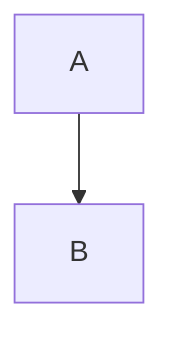
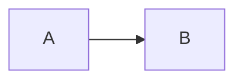

# Bonkei

> Mermaid diagrams, as a 3D scene (flat, iso, 3D).

Bonkei turns Mermaid into one Three.js scene (Mermaid → ELK → react-three-fiber) that you can view **flat, isometric or 3D**, with animated camera transitions.

- Flowcharts: nested subgraphs become trays, nodes are extruded shapes (rect, round, cylinder, diamond), edges follow ELK's orthogonal routes.
- Sequence diagrams: participants, lifelines on the ground, messages, activations as raised bars, `loop`/`alt`/`opt`/`par` blocks as translucent trays.
- Drag nodes (kept inside their subgraph; edges reroute live), click a subgraph to fly in, edit the source live, pick from built-in samples.

## Use it

The documentation is at **https://bonkei.dev/docs/**: getting started for React, plain JavaScript, a script tag and VitePress, every option, control, edge style, theme and error with live diagrams, and the API reference. Agents can read it without a browser: [`llms.txt`](https://bonkei.dev/docs/llms.txt), [`llms-full.txt`](https://bonkei.dev/docs/llms-full.txt), and any page's Markdown at its address plus `.md`.

`bonkei` exports one component, one function and their types. It is an ESM package with TypeScript types; importing it runs nothing. Your app supplies `react`, `react-dom` (React 19: the same range React Three Fiber accepts, today `>=19 <19.4`) and `three`:

```bash
npm install bonkei react react-dom three
```

Nothing else: `@opentelemetry/api` comes with Bonkei, and a default Vite config works as it is (`examples/vite` is such an app). The layout engine (ELK) and the line router (`libavoid.wasm`) are fetched when the first diagram is laid out, not with the page. Bonkei finds the wasm beside its own module; if your bundler moves it (Vite 5's dev pre-bundling does), it falls back to a lazy chunk holding the same bytes. `setAvoidWasm(url)` from `bonkei/internal` points elsewhere. The Bonkei themes' label font (Zen Old Mincho, SIL OFL, in `dist/fonts/` with its licence) is found the same way, beside the module, and fetched only when a theme first uses it; if your bundler moves it, the labels use the default font and `onWarning` says so.

With a script tag and no build step, load `bonkei.global.js` (React, three and ELK inside) with `libavoid.wasm` and the `fonts/` folder in the same folder, and call `Bonkei.render(element, source, options)`:

```html
<div id="diagram" style="height:480px"></div>
<script src="bonkei.global.js"></script>
<script>Bonkei.render(document.getElementById('diagram'), 'flowchart LR\n  A --> B')</script>
```

All three are in the package's `dist/`, laid out as they should be served:

```
bonkei.global.js
libavoid.wasm
fonts/ZenOldMincho-Bold-latin.ttf   (the Bonkei themes' labels; OFL-ZenOldMincho.txt beside it)
```

Like the wasm, the font is looked for beside the script that loaded `bonkei.global.js`. Leave `fonts/` out and Bonkei-theme labels fall back to the default font, with a warning to `onWarning`.

The script also defines a `<bonkei-diagram>` element, so a page needs no code at all (BON-53; `examples/html`):

```html
<script src="bonkei.global.js"></script>
<bonkei-diagram height="480" theme="bonkei">
  flowchart LR
    A --> B
</bonkei-diagram>
```

Its text is the diagram (indented as you like; write `<` and `&` in labels as `&lt;` and `&amp;`). `height` (a number is px; 420 px when nothing else gives it a height), `mode` and `theme` are attributes; it fires `bonkei-ready` and `bonkei-error`. Removed, it releases its scene; added later, it draws. `<pre class="mermaid">` blocks become diagrams only when the page asks: `Bonkei.run({ querySelector: 'pre.mermaid' })` converts the flowcharts and sequence diagrams and leaves any other type as it is.

In a VitePress site, `@bonkei/vitepress` (`packages/vitepress`, not yet published) draws ` ```mermaid ` fences that hold a flowchart or a sequence diagram as Bonkei scenes; see its README and `examples/vitepress`. For Mintlify, what it allows and the likely route are in `examples/vitepress/mintlify.md`.

With React:

```tsx
import { Bonkei, type BonkeiError } from 'bonkei'

const src = `flowchart TD
  A[Start] --> B{Ok?}
  B -->|yes| C[(Store)]`

export function Diagram() {
  return (
    <div style={{ height: 480 }}>
      <Bonkei
        source={src}
        mode="iso"
        controls={{ zoom: false }}
        onError={(e: BonkeiError) => console.error(e.kind, e.line, e.message)}
        onNodeClick={n => console.log('clicked', n.kind, n.id)}
      />
    </div>
  )
}
```

Without React (`render` mounts its own React root; your page never touches React):

```ts
import { render } from 'bonkei'

const handle = render(document.getElementById('diagram')!, 'flowchart LR\n  A --> B', {
  toolbar: false,
  onReady: r => console.log(`${r.nodes} nodes, layout ${r.layoutMs} ms`),
})

handle.update('flowchart LR\n  A --> B --> C') // new source, same view; a failed update keeps the last diagram
handle.setTheme('bonkei')                      // new theme, same view (undefined: back to the frontmatter's)
handle.setMode('3d')                           // fires onModeChange with source 'handle'
handle.fit()                                   // frame the whole diagram again
handle.destroy()                               // unmount; later calls do nothing
```

A `<Bonkei />` ref gives the same `setMode()` and `fit()` (`BonkeiViewHandle`). Each instance has its own camera and state, so several on one page share nothing.

Only the first draw frames the diagram. After that a new layout (a new source, a new theme, another Avoid crossings level) leaves the view where the reader put it: the same position, zoom and angle, and the same tray if they had flown into one. What is on screen stays put on screen even where the diagram grows or shrinks around it; something added out of view stays out of view until the reader moves there or presses Fit. Fit and Flat / Iso / 3D frame the diagram as before; if the tray the reader was in has been deleted, the next of those frames the nearest tray that held it, or the whole diagram.

Props of `<Bonkei />`, and the options of `render(element, source, options)`:

| Option | Type | Default | Meaning |
| --- | --- | --- | --- |
| `source` | `string \| GraphInput` | (required) | Mermaid text (frontmatter allowed) or a hand-built graph. For `render` it is the second argument. |
| `mode` | `'flat' \| 'iso' \| '3d'` | `'iso'` | The camera mode. Sets the first view; changing it moves the view. Iso by default; set `'flat'` for a plain diagram. |
| `labels` | `'top' \| 'billboard'` | `'top'` | Labels lie on top of the shapes, or face the camera. |
| `toolbar` | `boolean` | `true` | Show the built-in Flat / Iso / 3D switch, Fit and **?** (the gesture card). |
| `crossingControls` | `boolean` | `false` | Also show the crossing-style (No hop / Bridge / Tunnel / Portal) and Avoid crossings (Off / Some / Strong) groups in the toolbar; needs `toolbar`. |
| `controls` | `boolean \| { zoom?, pan?, move?, drillIn? }` | `true` | The reader's controls: all on, all off, or per control (one left out is on). |
| `crossings` | `'none' \| 'bridge' \| 'tunnel' \| 'portal'` | `'none'` | How a line gets past another where two cross: not at all (they cross flat), a hop over it, an open trough under it, or a pair of portals. With `crossingControls` on, the reader can switch it too, and the diagram redraws at once. |
| `avoidCrossings` | `'off' \| 'some' \| 'strong'` | `'some'` | How hard lines avoid crossing each other. `some` keeps every line on its most direct route; `strong` lets a line take a short sideways jog to cross fewer lines. With `crossingControls` on, the reader can switch it too, and the lines are routed again at once. |
| `theme` | `string \| Theme` | from the frontmatter, else `'classic'` | The look: `'classic'`, `'bonkei'` or `'bonkei-landscape'` (`THEME_NAMES`), or a whole `Theme` object (copy one of `CLASSIC`, `BONKEI`, `BONKEI_LANDSCAPE` and change it). Wins over the frontmatter's `config.theme`. An unknown name draws in Classic and warns. |
| `fit` | `'default' \| 'tight'` | `'default'` | `tight` frames what the view really shows (the diagram's boxes as the camera sees them) with a small margin, centres it, and frames it again when the container changes size. |
| `minLabelPx` | `number` | `0` | When showing the whole diagram would make node labels smaller than this many pixels (a phone), open zoomed in on the largest tray instead. `fit()` still shows everything. |
| `onError` | `(error: BonkeiError) => void` | | Nothing could be drawn. |
| `onWarning` | `(warning: BonkeiWarning) => void` | | Something was skipped; the diagram still draws. |
| `onModeChange` | `(mode: Mode, change: { source }) => void` | | The view moved to another mode. |
| `onNodeClick` | `(node: NodeClick) => void` | | A node, group or participant was clicked. |
| `onReady` | `(ready: ReadyInfo) => void` | | A new source's first frame is drawn. |

How lines are drawn (flowcharts): every line meets a node at the middle of one of its sides, halfway up the block, and runs around blocks and around trays it does not go into. An edge to a subgraph meets the tray's rim at the middle of a side. Where a line's two ends sit at different heights (a tray, a nested tray, a taller block) it makes one vertical step to the height of where it is headed, just outside the outermost tray edge it crosses. Steps are always on. In flat view the light is nearly overhead, so shadows are short. Lines are routed by [libavoid](https://github.com/Aksem/libavoid-js) (LGPL-2.1-or-later), which ships as its own `libavoid.wasm` beside Bonkei; if it cannot load, the layout's own routes are used.

How a reader moves around (the same in every view and wherever a diagram is shown): a two-finger drag or the scroll wheel moves it (⇧ for sideways), pinch or ⌘/Ctrl + scroll zooms. In flat and iso a background drag moves and ⇧ + drag or a right-drag turns, settling on the nearest quarter turn; in 3D a drag turns and tilts, and ⇧ swaps drag and scroll. On touch, one finger moves, pinch zooms and a twist turns. Fit shows the whole diagram and puts it back square; **?** beside it lists the gestures for the trackpad, mouse or touch screen in use. A diagram in a page that scrolls lets the page scroll past it with a short hint, until a click takes hold of it (Esc or a click outside lets go). There is no right-click menu over a diagram. The full table is in the docs, "The reader's controls".

What the callbacks mean:

- **`onError` fires only when nothing could be drawn**: once per failure, with `kind` `parse` (no node or participant could be read; `line` names the first unreadable line), `graph` (a hand-built graph with no nodes or an edge to an unknown id), `layout` (the layout failed) or `render` (drawing failed, e.g. no WebGL). The diagram shows an inline message instead; nothing is thrown. A failed update keeps the last diagram and shows a strip. `isBonkeiError(x)` tells a `BonkeiError` from anything else.
- **`onWarning` fires once per dropped line, bad frontmatter key, unknown theme or bad theme variable, and the diagram still draws.** `kind` is `dropped` (with the reason, e.g. `not supported yet`), `frontmatter` or `theme` (`line` 0 when the name came from the `theme` prop); `line` counts the source as you wrote it, frontmatter included.
- `onReady({ layoutMs, nodes, edges, dropped })` fires once per new source, after its first frame is drawn, already framed. `layoutMs` is layout time only (not parsing, not drawing).
- `onModeChange(mode, { source })` reports where the change came from: `toolbar`, `handle` (`setMode()`) or `prop` (a changed `mode`). The first view is not a change.
- `onNodeClick({ id, label, kind })` fires for nodes, groups and sequence participants (`kind`: `node`, `group`, `participant`), on a click rather than a drag, whatever `controls` say.

The same options (not the callbacks) can live in the diagram, under `config.bonkei` in Mermaid's frontmatter. Props win, key by key; a `controls` object in props replaces the frontmatter's whole.



### Themes

A theme is the diagram's whole look as data: colours, light, materials, outlines, tray sides, label plates and lines (`Theme`, JSON). Three come built in:

- **Classic** (`classic`, the default): the dark scene Bonkei has always drawn.
- **Bonkei** (`bonkei`): drawn from the 1848 tray-landscape prints. Cream paper ground, ink outlines, flat washes, tray sides patterned by how deep they are nested, labels on plaques, and lines in ink that keep their steps, tunnels, portals and arrowheads.
- **Bonkei · landscape** (`bonkei-landscape`): Bonkei, with every node a house, bonsai, rock or peak (by shape) on a raised plinth in its footprint, its label in front.

A tunnel's trench can be lit (`edge.glow`): a light along the floor, a wash on the walls and a rim round the lip (`edge.rim`). Classic lights it grey-white at 30% with no rim; the Bonkei themes leave the light off. Each part can be recoloured, made stronger or weaker, or turned off by a diagram's `themeVariables` (`edge.glow: off`, `edge.glow.core: null`, `edge.rim: none`); the docs' Edge styles page has controls to try it.

A diagram names its theme in its frontmatter, Mermaid's way, and can override single settings for itself alone with `themeVariables` (dotted token paths, or nested maps):



Or pass `theme` to the component (`<Bonkei source={src} theme="bonkei-landscape" />`); it wins over the frontmatter's name, and the frontmatter's `themeVariables` still apply on top. A name nobody knows, a variable that does not exist, or a value of the wrong type or not one of a token's words (`node.form: castle`), or a negative number draws in Classic or skips that variable, and goes to `onWarning` with `kind: 'theme'`. The built-in themes are frozen; to make your own, copy one (`{ ...BONKEI, edge: { ...BONKEI.edge, color: '#333' } }`) and pass it as `theme`. In the Bonkei themes the ink follows the drawing's scale (`ink`), so outlines, patterns and labels stay in proportion from a phone to a desktop.

A `Graph` works as a source too. `direction` and `groups` are optional (they default to `TD` and none), and an inline object is fine: it is compared by content, so re-creating it on every render does not lay it out again.

```tsx
<Bonkei source={{
  nodes: [{ id: 'a', label: 'API', shape: 'rect' }, { id: 'db', label: 'DB', shape: 'cylinder' }],
  edges: [{ id: 'e1', from: 'a', to: 'db', label: 'reads' }],
}} />
```

Sizing: Bonkei fills its container (`width: 100%; height: 100%`). Give the container a height; one with no height draws nothing and `onReady` does not fire. The root carries `data-bonkei="loading|ready|error"` for styling and tests.

Telemetry: Bonkei emits OpenTelemetry spans through `@opentelemetry/api` when the page registers an SDK, and does nothing otherwise. The spans are `bonkei.prepare` (with a `bonkei.layout` child; under it `bonkei.elk.load` on the first layout and `bonkei.route`, with `bonkei.wasm.load` and its `bonkei.wasm.fallback` event when the inline copy was used; `bonkei.theme.requested` when the frontmatter names a theme, and a `bonkei.frontmatter_warning` event per warning with its `bonkei.warning.kind`), `bonkei.theme` (each look a diagram is drawn in: the theme, where it came from, how many variables, `bonkei.theme.unknown`, and `bonkei.theme.trench`: the parts of the trench light it draws, such as `core,halo,wash`, `rim` or `off`), `bonkei.first_frame` (with `bonkei.theme`, `bonkei.mode` (the view it opened in) and `bonkei.crossing_controls`), `bonkei.mode_change`, `bonkei.node_click`, `bonkei.control` (one per gesture: `bonkei.control` zoom, pan, turn or move; `bonkei.control.via` wheel, pinch, drag or touch; `bonkei.control.swapped` when reached with Shift or the right button; `bonkei.mode`), `bonkei.control.hint` (the hint over a diagram in a page that scrolls, once each time it shows), `bonkei.control.hold` (`taken` or `let_go`, and how), `bonkei.help` (the gesture card opened or closed, how, for which input and view), `bonkei.fit` (with `bonkei.fit.after_edits`: how many new layouts the view kept its place through before Fit was pressed), `bonkei.relayout_kept_view` (each new layout after the first: `bonkei.view.anchor` node, tray or origin (what the view was lined up on), `bonkei.view.tray` none, found, parent or diagram (the tray flown into, found again, replaced by the one that held it, or gone), `bonkei.view.shift` in world units, `bonkei.view.edits`, `bonkei.mode`) and `bonkei.render_error`. The script tag adds `bonkei.element.connect` / `bonkei.element.disconnect` (a `<bonkei-diagram>` added or removed), `bonkei.element.bad_height`, `bonkei.element.theme_change` (a drawn element's `theme` attribute changed) and `bonkei.run` (how many blocks it converted and skipped); `@bonkei/vitepress` adds `bonkei.vitepress.load` (the ms to load Bonkei on a page with a diagram, status ERROR when it could not).

The site (`apps/site`) emits its own spans the same way, on the `bonkei-site` tracer (`apps/site/src/track.ts`, which loads `@opentelemetry/api` on first use so the page's entry chunk does not carry it), for the hero: `site.hero.path` (`live`, or `poster` with `site.hero.reason` phone, no-webgl2 or forced), `site.hero.ready` (the scene's first frame, `site.hero.ready_ms`) and `site.hero.fallback` (status ERROR, the poster shows: `site.hero.reason` load-error, the scene's chunk failed, or scene-error, the scene reported an error before its first frame or its drawing broke, with `site.hero.error.kind`); for the "Keep the text" section: `site.how.fallback` (`site.how.reason` phone, no-webgl2, scene-error or load-error; status ERROR for scene-error and load-error), `site.how.live` (the first draw, `site.how.ms` from the scene's mount, `site.how.load_ms` from the section's first render), `site.how.first_edit` (once per visit), `site.how.update` (each source the scene was given after the first: `site.how.outcome` drawn, skipped or not-updated, `site.how.skipped`, `site.how.ms`, `site.how.edits`, `site.how.error.kind`) and `site.how.reset`. Counts and states only, never the typed text. The scene's own `bonkei.*` spans (`bonkei.fit`, `bonkei.mode_change`, `bonkei.relayout_kept_view`) cover Fit, the view buttons and the kept view.

## Packages

The repo is a pnpm workspace (`pnpm-workspace.yaml`); the root `bonkei-workspace` is a private shell.

- `packages/core` — **`bonkei`**: the engine and its public API (`<Bonkei />`, `render()`), built by tsdown into `dist/` (ESM, types, the script-tag bundle). Private for now; it will be published later. The apps, Storybook and `examples/vite` use the built `dist/`, not the source.
- `packages/vitepress` — **`@bonkei/vitepress`** (private, not yet published): a markdown-it plugin and a Vue component that draw ` ```mermaid ` flowcharts and sequence diagrams in VitePress (BON-53).
- `examples/html` — one static HTML page with the script tag and `<bonkei-diagram>` elements (BON-53).
- `examples/vitepress` — a VitePress docs site with the plugin, and the Mintlify notes (BON-53).
- `examples/vite` — a fresh `npm create vite` React app with `bonkei` added: what CI's smoke test installs the packed tarball into, and each PR's StackBlitz template on pkg.pr.new. Its other pieces (parser, layout, renderer, camera) are in `bonkei/internal`, which is internal and unstable.
- `apps/playground` — **`@bonkei/playground`** (private): the viewer, its stories, Storybook and the screen map.
- `apps/site` — **`@bonkei/site`** (private): the marketing site, its stills and OG images, and the capture page behind `pnpm capture`. Its "Keep the text. Get the scene." section is live on a desktop with WebGL 2: the Mermaid source is an editor and the scene beside it re-lays itself out 300 ms after you stop typing, keeping the view where you put it; a line it can't read is named under the source, and text with nothing readable keeps the last diagram. A phone or a browser without WebGL 2 gets the source and a 2x still (`still-iso.png`). The scene is a lazy chunk (`HowScene.tsx`), fetched when the section comes near the screen (BON-189).
- `docs` — the docs site at bonkei.dev/docs/ (VitePress, BON-178). **Not a workspace member**: it installs `bonkei` and `@bonkei/vitepress` from `pnpm pack` tarballs with npm (`docs/package-lock.json` pins the rest), the way a user would.

Both apps import the engine only through its public `bonkei` exports (stories may also use `bonkei/internal`); core never imports from an app.

```bash
pnpm install
pnpm dev          # core rebuilt on save (tsdown --watch) + both apps: site at http://localhost:5173/, viewer at /app/, script-tag page at /app/embed/
SITE_PORT=6100 VIEWER_PORT=6101 pnpm dev   # any ports; /app goes to that viewer
pnpm build        # build core, type-check everything, build both apps and the docs, assemble dist/ (site) + dist/app/ (viewer) + dist/docs/ (docs), check it
pnpm docs:dev     # pack core and the VitePress plugin, npm install the tarballs into docs/, generate the API pages, vitepress dev
pnpm docs:build   # the same, then vitepress build into docs/.vitepress/dist
pnpm docs:smoke   # build the docs, then every page, the agent files, coverage, a broken sample, and the four getting-started pages followed word for word
pnpm check:package # build core, then publint, are-the-types-wrong and the dist checks
pnpm size         # build core, then the size budget (packages/core/.size-limit.mjs)
pnpm smoke        # after building core: pack it, install into a clean examples/vite, draw under vite dev and preview, the script-tag page, the embeds (examples/html, examples/vitepress). The docs run (pnpm docs:smoke, above) is not part of it: it runs nightly on main (.github/workflows/nightly.yml), and `pnpm docs:smoke` runs it by hand
pnpm preview      # serve the assembled dist/ at /
pnpm storybook    # stories: node shape, subgraph, full sample, sequence, site screens
pnpm capture      # regenerate apps/site/public/*.png from the real scene (needs Chrome; CHROME_PATH to override)
pnpm test         # unit tests: parser, options, prepare, camera, controls
```

`SITE_PORT` and `VIEWER_PORT` default to 5173 and 5174 and are read from the shell, not from `.env` files. A set `SITE_PORT` is strict: the site fails to start if the port is taken instead of moving to another; the viewer is always strict. So several copies (prototypes, smoke tests, your own) can run at once, each site showing its own viewer at /app.

In dev, the viewer's plain page at http://localhost:5173/app/plain.html drives `render()` and its handle on a page with no React of its own.

Public site: https://bonkei.dev/ (viewer at https://bonkei.dev/app/). It deploys to GitHub Pages through `.github/workflows/pages.yml`. Every push to main deploys; the workflow can still be run by hand from the Actions tab (`workflow_dispatch`). The custom domain is set once in the repository's Settings → Pages (source: GitHub Actions).

Two Vite apps, one Pages artifact: `apps/site` is the marketing site (`index.html`, code in `apps/site/src/`), and `apps/playground` is the viewer (`index.html`, `apps/playground/src/main.tsx`). `pnpm build` builds both, `scripts/build-docs.mjs` builds the docs, and `scripts/assemble-pages.mjs` puts the site at `dist/`, the viewer at `dist/app/` and the docs at `dist/docs/`; builds, `pnpm preview` and dev serve the site at `/` and the viewer at `/app/` (in dev the site's dev server proxies `/app` to the viewer's own server). `pnpm build` ends with `scripts/check-pages.mjs`, which fails the build (and so the deploy) if anything in `dist/` mentions merman, if a page points at a file that is not in `dist/`, if `dist/index.html` lacks the `https://bonkei.dev/` `og:url` and `og:image` or a Bonkei title, if the viewer's title does not say Bonkei, if `dist/CNAME` is not `bonkei.dev`, or if the docs lack their index, `llms.txt`, `llms-full.txt`, a page's `.md` or the script-tag files, point at a missing file or at the workspace, or the site's header has no Docs link. `node scripts/serve-dist.mjs` serves `dist/` like Pages on `$PORT` (clean URLs, `/docs/` included).

Stack: Vite, React, react-three-fiber, drei (troika text), elkjs. Parser, ELK layout (`packages/core/src/layout.ts`, swappable behind `layout(graph)`) and sequence layout (`packages/core/src/seq.ts`) are our own.

**Status: prototype.** Known gaps: ELK routes cross-subgraph edges badly on big diagrams; flat/iso use a 1° perspective camera rather than a true orthographic one; tests cover the parsers, options, `prepare`, the camera and the controls, not the rendered scene (the stills from `pnpm capture` stand in for that).

## The screen map

Storybook (`pnpm storybook`) draws a map of the screens from `apps/playground/src/flows/*.flow.json`: open the Map page under Docs and zoom out. Add a screen by adding its page story to a node there, whole screens only.
