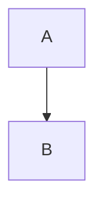
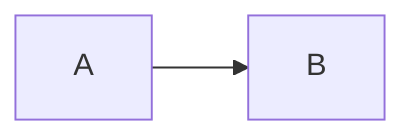

# Bonkei

> Mermaid diagrams, as a 3D scene (flat, iso, 3D).

Bonkei turns Mermaid into one Three.js scene (Mermaid → ELK → react-three-fiber) that you can view **flat, isometric or 3D**, with animated camera transitions.

- Flowcharts: nested subgraphs become trays, nodes are extruded shapes (rect, round, cylinder, diamond), edges follow ELK's orthogonal routes.
- Sequence diagrams: participants, lifelines on the ground, messages, activations as raised bars, `loop`/`alt`/`opt`/`par` blocks as translucent trays.
- Drag nodes (kept inside their subgraph; edges reroute live), click a subgraph to fly in, edit the source live, pick from built-in samples.

## Use it

`bonkei` exports one component, one function and their types. It needs `react`, `react-dom` and `three` as peers (and `@opentelemetry/api`, see below).

With React:

```tsx
import { Bonkei, type BonkeiError } from 'bonkei'

const src = `flowchart TD
  A[Start] --> B{Ok?}
  B -->|yes| C[(Store)]`

export function Diagram() {
  return (
    <div style={{ height: 480 }}>
      <Bonkei
        source={src}
        mode="iso"
        controls={{ zoom: false }}
        onError={(e: BonkeiError) => console.error(e.kind, e.line, e.message)}
        onNodeClick={n => console.log('clicked', n.kind, n.id)}
      />
    </div>
  )
}
```

Without React (`render` mounts its own React root; your page never touches React):

```ts
import { render } from 'bonkei'

const handle = render(document.getElementById('diagram')!, 'flowchart LR\n  A --> B', {
  toolbar: false,
  onReady: r => console.log(`${r.nodes} nodes, layout ${r.layoutMs} ms`),
})

handle.update('flowchart LR\n  A --> B --> C') // new source, same view; a failed update keeps the last diagram
handle.setMode('3d')                           // fires onModeChange with source 'handle'
handle.fit()                                   // frame the whole diagram again
handle.destroy()                               // unmount; later calls do nothing
```

A `<Bonkei />` ref gives the same `setMode()` and `fit()` (`BonkeiViewHandle`). Each instance has its own camera and state, so several on one page share nothing.

Props of `<Bonkei />`, and the options of `render(element, source, options)`:

| Option | Type | Default | Meaning |
| --- | --- | --- | --- |
| `source` | `string \| GraphInput` | (required) | Mermaid text (frontmatter allowed) or a hand-built graph. For `render` it is the second argument. |
| `mode` | `'flat' \| 'iso' \| '3d'` | `'iso'` | The camera mode. Sets the first view; changing it moves the view. |
| `labels` | `'top' \| 'billboard'` | `'top'` | Labels lie on top of the shapes, or face the camera. |
| `toolbar` | `boolean` | `true` | Show the built-in flat/iso/3D switch and the fit button. |
| `controls` | `boolean \| { zoom?, pan?, move?, drillIn? }` | `true` | The reader's controls: all on, all off, or per control (one left out is on). |
| `crossings` | `'none' \| 'bridge' \| 'tunnel' \| 'portal'` | `'none'` | How a line gets past another where two cross: not at all (they cross flat), a hop over it, an open trough under it, or a pair of portals. The toolbar switches it, and the diagram redraws at once. |
| `avoidCrossings` | `'off' \| 'some' \| 'strong'` | `'some'` | How hard lines avoid crossing each other. `some` keeps every line on its most direct route; `strong` lets a line take a short sideways jog to cross fewer lines. The toolbar switches it, and the lines are routed again at once. |
| `theme` | `string \| Theme` | from the frontmatter, else `'classic'` | The look: `'classic'`, `'bonkei'` or `'bonkei-landscape'` (`THEME_NAMES`), or a whole `Theme` object (copy one of `CLASSIC`, `BONKEI`, `BONKEI_LANDSCAPE` and change it). Wins over the frontmatter's `config.theme`. An unknown name draws in Classic and warns. |
| `fit` | `'default' \| 'tight'` | `'default'` | `tight` frames what the view really shows (the diagram's boxes as the camera sees them) with a small margin, centres it, and frames it again when the container changes size. |
| `minLabelPx` | `number` | `0` | When showing the whole diagram would make node labels smaller than this many pixels (a phone), open zoomed in on the largest tray instead. `fit()` still shows everything. |
| `onError` | `(error: BonkeiError) => void` | | Nothing could be drawn. |
| `onWarning` | `(warning: BonkeiWarning) => void` | | Something was skipped; the diagram still draws. |
| `onModeChange` | `(mode: Mode, change: { source }) => void` | | The view moved to another mode. |
| `onNodeClick` | `(node: NodeClick) => void` | | A node, group or participant was clicked. |
| `onReady` | `(ready: ReadyInfo) => void` | | A new source's first frame is drawn. |

How lines are drawn (flowcharts): every line meets a node at the middle of one of its sides, halfway up the block, and runs around blocks and around trays it does not go into. An edge to a subgraph meets the tray's rim at the middle of a side. Where a line's two ends sit at different heights (a tray, a nested tray, a taller block) it makes one vertical step to the height of where it is headed, just outside the outermost tray edge it crosses. Steps are always on. In flat view the light is nearly overhead, so shadows are short. Lines are routed by [libavoid](https://github.com/Aksem/libavoid-js) (LGPL-2.1-or-later), which ships as its own `libavoid.wasm` beside Bonkei; if it cannot load, the layout's own routes are used.

What the callbacks mean:

- **`onError` fires only when nothing could be drawn**: once per failure, with `kind` `parse` (no node or participant could be read; `line` names the first unreadable line), `graph` (a hand-built graph with no nodes or an edge to an unknown id), `layout` (the layout failed) or `render` (drawing failed, e.g. no WebGL). The diagram shows an inline message instead; nothing is thrown. A failed update keeps the last diagram and shows a strip. `isBonkeiError(x)` tells a `BonkeiError` from anything else.
- **`onWarning` fires once per dropped line, bad frontmatter key, unknown theme or bad theme variable, and the diagram still draws.** `kind` is `dropped` (with the reason, e.g. `not supported yet`), `frontmatter` or `theme` (`line` 0 when the name came from the `theme` prop); `line` counts the source as you wrote it, frontmatter included.
- `onReady({ layoutMs, nodes, edges, dropped })` fires once per new source, after its first frame is drawn, already framed. `layoutMs` is layout time only (not parsing, not drawing).
- `onModeChange(mode, { source })` reports where the change came from: `toolbar`, `handle` (`setMode()`) or `prop` (a changed `mode`). The first view is not a change.
- `onNodeClick({ id, label, kind })` fires for nodes, groups and sequence participants (`kind`: `node`, `group`, `participant`), on a click rather than a drag, whatever `controls` say.

The same options (not the callbacks) can live in the diagram, under `config.bonkei` in Mermaid's frontmatter. Props win, key by key; a `controls` object in props replaces the frontmatter's whole.



### Themes

A theme is the diagram's whole look as data: colours, light, materials, outlines, tray sides, label plates and lines (`Theme`, JSON). Three come built in:

- **Classic** (`classic`, the default): the dark scene Bonkei has always drawn.
- **Bonkei** (`bonkei`): drawn from the 1848 tray-landscape prints. Cream paper ground, ink outlines, flat washes, tray sides patterned by how deep they are nested, labels on plaques, and lines in ink that keep their steps, tunnels, portals and arrowheads.
- **Bonkei · landscape** (`bonkei-landscape`): Bonkei, with every node a house, bonsai, rock or peak (by shape) on a raised plinth in its footprint, its label in front.

A diagram names its theme in its frontmatter, Mermaid's way, and can override single settings for itself alone with `themeVariables` (dotted token paths, or nested maps):



Or pass `theme` to the component (`<Bonkei source={src} theme="bonkei-landscape" />`); it wins over the frontmatter's name, and the frontmatter's `themeVariables` still apply on top. A name nobody knows, a variable that does not exist, or a value of the wrong type or not one of a token's words (`node.form: castle`) draws in Classic or skips that variable, and goes to `onWarning` with `kind: 'theme'`. The built-in themes are frozen; to make your own, copy one (`{ ...BONKEI, edge: { ...BONKEI.edge, color: '#333' } }`) and pass it as `theme`. In the Bonkei themes the ink follows the drawing's scale (`ink`), so outlines, patterns and labels stay in proportion from a phone to a desktop.

A `Graph` works as a source too. `direction` and `groups` are optional (they default to `TD` and none), and an inline object is fine: it is compared by content, so re-creating it on every render does not lay it out again.

```tsx
<Bonkei source={{
  nodes: [{ id: 'a', label: 'API', shape: 'rect' }, { id: 'db', label: 'DB', shape: 'cylinder' }],
  edges: [{ id: 'e1', from: 'a', to: 'db', label: 'reads' }],
}} />
```

Sizing: Bonkei fills its container (`width: 100%; height: 100%`). Give the container a height; one with no height draws nothing and `onReady` does not fire. The root carries `data-bonkei="loading|ready|error"` for styling and tests.

Telemetry: Bonkei emits OpenTelemetry spans through `@opentelemetry/api` when the page registers an SDK, and does nothing otherwise. The spans are `bonkei.prepare` (with a `bonkei.layout` child; `bonkei.theme.requested` when the frontmatter names a theme, and a `bonkei.frontmatter_warning` event per warning with its `bonkei.warning.kind`), `bonkei.theme` (each look a diagram is drawn in: the theme, where it came from, how many variables, and `bonkei.theme.unknown`), `bonkei.first_frame` (with `bonkei.theme`), `bonkei.mode_change`, `bonkei.node_click`, `bonkei.control` and `bonkei.render_error`.

## Packages

The repo is a pnpm workspace (`pnpm-workspace.yaml`); the root `bonkei-workspace` is a private shell.

- `packages/core` — **`bonkei`**: the engine and its public API (`<Bonkei />`, `render()`). Private for now; it will be published later. Its other pieces (parser, layout, renderer, camera) are in `bonkei/internal`, which is internal and unstable.
- `apps/playground` — **`@bonkei/playground`** (private): the viewer, its stories, Storybook and the screen map.
- `apps/site` — **`@bonkei/site`** (private): the marketing site, its stills and OG images, and the capture page behind `pnpm capture`.

Both apps import the engine only through its public `bonkei` exports (stories may also use `bonkei/internal`); core never imports from an app.

```bash
pnpm install
pnpm dev          # both apps: site at http://localhost:5173/, viewer at /app/
pnpm build        # type-check everything, build both apps, assemble dist/ (site) + dist/app/ (viewer)
pnpm preview      # serve the assembled dist/ under /merman/
pnpm storybook    # stories: node shape, subgraph, full sample, sequence, site screens
pnpm capture      # regenerate apps/site/public/*.png from the real scene (needs Chrome; CHROME_PATH to override)
pnpm test         # unit tests: parser, options, prepare, camera, controls
```

In dev, the viewer's plain page at http://localhost:5173/app/plain.html drives `render()` and its handle on a page with no React of its own.

Public site: https://infinitedusky.github.io/merman/ (live after the first deploy). It deploys to GitHub Pages through `.github/workflows/pages.yml`. For now that workflow runs only when started by hand (`workflow_dispatch`), so merging to main publishes nothing.

Two Vite apps, one Pages artifact: `apps/site` is the marketing site (`index.html`, code in `apps/site/src/`), and `apps/playground` is the viewer (`index.html`, `apps/playground/src/main.tsx`). `pnpm build` builds both and `scripts/assemble-pages.mjs` puts the site at `dist/` and the viewer at `dist/app/`; builds and `pnpm preview` serve them under `/merman/`. In dev they are served under `/`: the site's dev server proxies `/app` to the viewer's own server.

Stack: Vite, React, react-three-fiber, drei (troika text), elkjs. Parser, ELK layout (`packages/core/src/layout.ts`, swappable behind `layout(graph)`) and sequence layout (`packages/core/src/seq.ts`) are our own.

**Status: prototype.** Known gaps: ELK routes cross-subgraph edges badly on big diagrams; flat/iso use a 1° perspective camera rather than a true orthographic one; tests cover the parsers, options, `prepare`, the camera and the controls, not the rendered scene (the stills from `pnpm capture` stand in for that).

## The screen map

Storybook (`pnpm storybook`) draws a map of the screens from `apps/playground/src/flows/*.flow.json`: open the Map page under Docs and zoom out. Add a screen by adding its page story to a node there, whole screens only.
