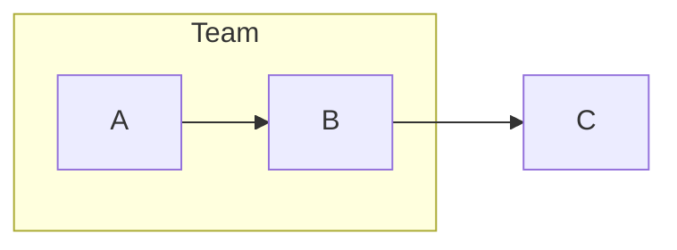
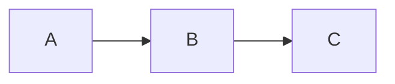
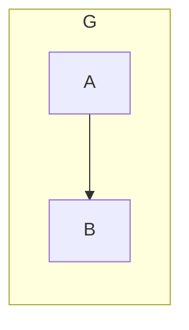

# The reader's controls

Four things a reader can do to a diagram: **zoom**, **pan**, **move** a node, and **drill in** (focus a group). `controls` switches them.

<div class="table-wrap">

| Control | What the reader can do |
| --- | --- |
| `zoom` | Pinch, or ⌘/Ctrl + scroll, to zoom |
| `pan` | Move the diagram (two-finger drag, scroll wheel, or dragging the background) and turn it |
| `move` | Drag a node to move it |
| `drillIn` | Click a group to zoom into it |

</div>

`controls: true` (the default) turns all on, `false` all off; an object switches each, and a control left out is on.

## Gestures

The same in every view, on this page, in the viewer, on the site and in the stories, like a map or a design tool. Press **?** beside **Fit** on any diagram for the list that matches the input you last used (trackpad, mouse or touch) and the current view.

<div class="table-wrap">

| | Flat and iso | 3D |
| --- | --- | --- |
| Move | Two-finger drag, scroll wheel (⇧ for sideways), or drag the background | Two-finger drag, scroll wheel, ⇧ + drag, or right-drag |
| Zoom | Pinch, or ⌘/Ctrl + scroll | Pinch, or ⌘/Ctrl + scroll |
| Turn | ⇧ + drag or right-drag; settles on the nearest quarter turn when let go (iso stays on its corners) | Drag (sideways turns, up and down tilts), or ⇧ + scroll |
| Touch | One finger moves, pinch zooms, a twist turns | The same, and two fingers up or down tilt |
| Fit | Shows the whole diagram and puts it back square | The same |

</div>

**When the diagram changes.** Only the first draw frames the diagram. After that a new layout (a new source, a new theme, another Avoid crossings level) leaves the view where the reader put it: the same position, zoom and angle, and the same tray if they had flown into one. What is on screen stays put on screen even where the diagram grows or shrinks around it; something added out of view stays out of view until the reader moves there or presses Fit. Fit and Flat / Iso / 3D frame the diagram as before; if the tray the reader was in has been deleted, the next of those frames the nearest tray that held it, or the whole diagram.

In 3D, Shift swaps drag and scroll: a drag turns and ⇧ + drag moves; the scroll wheel moves and ⇧ + scroll turns. 3D can be moved without a right mouse button.

**In a page that scrolls**, like this one, a diagram does not trap the page: scrolling over it scrolls the page, and a short hint says how to take hold ("Click to move the diagram"; on touch, "Tap, or use two fingers"). A click (or a tap, or two fingers) gives the diagram its gestures, shown by a ring that follows the rounded corners of whatever box clips the diagram and "Esc to let go", until you press Esc or click outside it. Pinch and ⌘/Ctrl + scroll zoom either way. A sideways two-finger swipe over the diagram is never handed to the page, so it does not make the browser go back a page; until the diagram is held it only shows the hint. A diagram that fills a page that does not scroll always has its gestures.

The browser's right-click menu never opens over a diagram: a right-drag (and Ctrl-click on a Mac) is a gesture there.

`controls.pan: false` switches off moving and turning, `controls.zoom: false` zooming; with zoom off, ⌘/Ctrl + scroll is left to the browser and the page.

## All on (the default)



## All off

````md
```mermaid
---
config:
  bonkei:
    controls: false
---
```
````


## One at a time

<div class="grid4">






</div>

<p class="cap">zoom off · pan off · move off · drillIn off</p>

## From code

```ts twoslash
import { render, type Controls } from 'bonkei'

const controls: Controls = { zoom: false, move: false } // pan and drillIn stay on
render(document.body, 'flowchart LR\n  A --> B', { controls })
```
