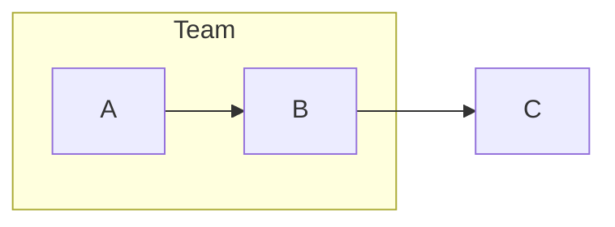
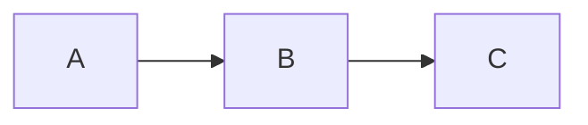
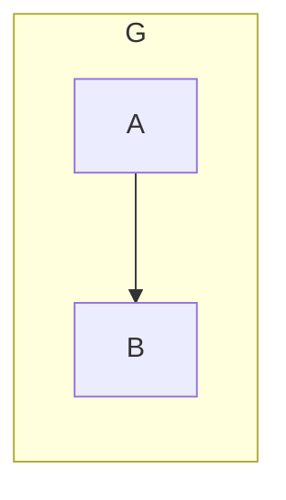

# The reader's controls

Four things a reader can do to a diagram: **zoom**, **pan**, **move** a node, and **drill in** (focus a group). `controls` switches them.

<div class="table-wrap">

| Control | What the reader can do |
| --- | --- |
| `zoom` | Scroll or pinch to zoom |
| `pan` | Drag the background to pan |
| `move` | Drag a node to move it |
| `drillIn` | Click a group to zoom into it |

</div>

`controls: true` (the default) turns all on, `false` all off; an object switches each, and a control left out is on.

## All on (the default)



## All off

````md
```mermaid
---
config:
  bonkei:
    controls: false
---
```
````


## One at a time

<div class="grid4">






</div>

<p class="cap">zoom off · pan off · move off · drillIn off</p>

## From code

```ts twoslash
import { render, type Controls } from 'bonkei'

const controls: Controls = { zoom: false, move: false } // pan and drillIn stay on
render(document.body, 'flowchart LR\n  A --> B', { controls })
```
