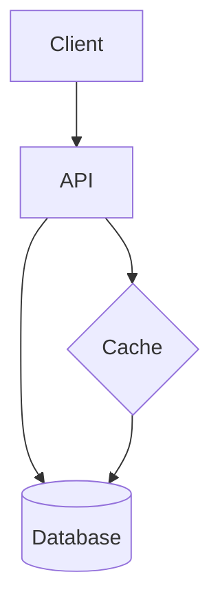
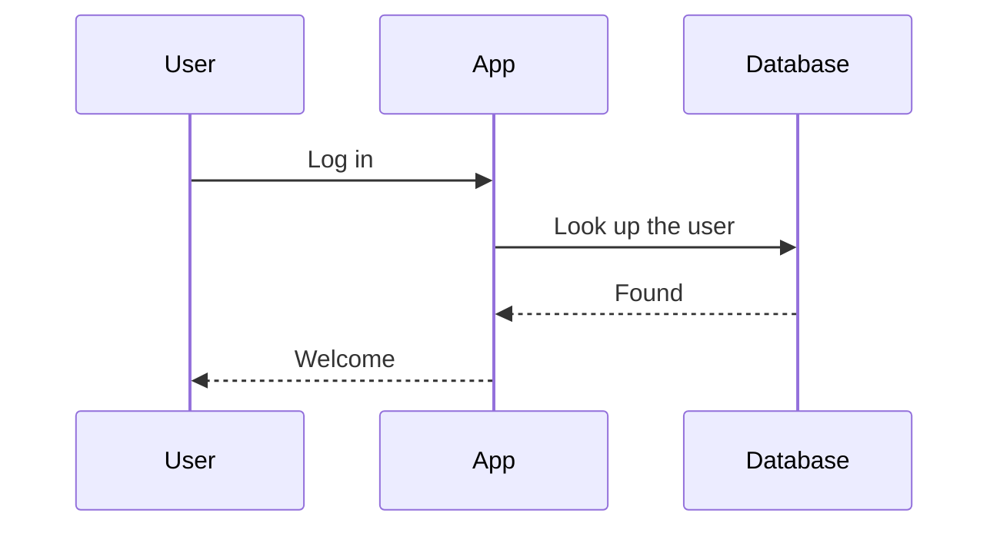
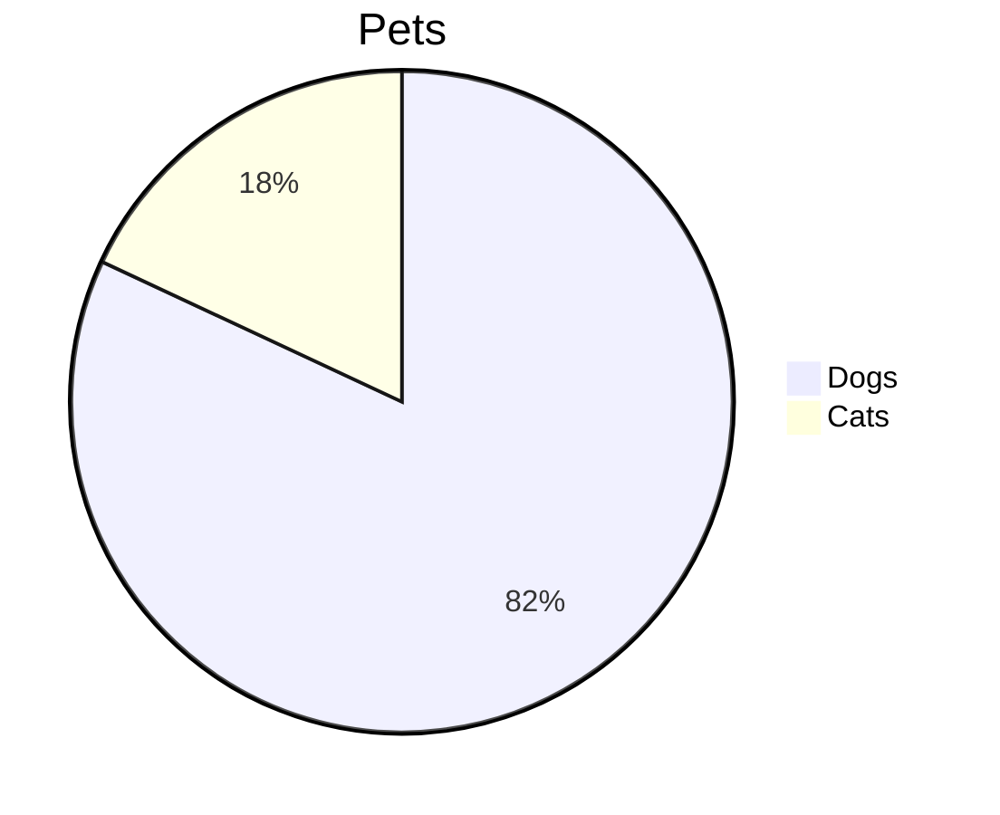

# Diagram types

Bonkei draws two Mermaid types today: **flowcharts** (`flowchart` or `graph`) and **sequence diagrams** (`sequenceDiagram`).

## Flowchart

## Sequence diagram

## Every other type

A type Bonkei does not draw is left to the site. In VitePress it shows as a code block, with no error and no empty box. This fence is a pie chart:

The same rule holds in the other ways in: `Bonkei.run()` leaves a `<pre class="mermaid">` that is not a flowchart or sequence diagram as text, and `render()` reports a diagram it cannot parse through [`onError`](./errors).

There is no page for a type that is not drawn. When one ships, it gets its own page here.
