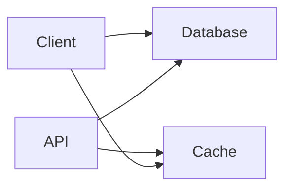
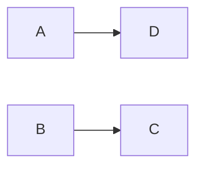
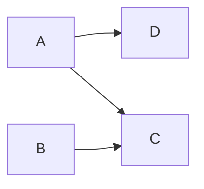

# Edge styles

How Bonkei draws two lines that cross, and how hard it tries to keep them apart.

````md

````


Drag it to turn it; Flat / Iso / 3D and Fit switch the view.

## Crossings

When two lines must cross, `crossings` says how the crossing is drawn. The default is `none`.

<div class="grid4">




</div>

<p class="cap">none · bridge · tunnel · portal</p>

## Avoiding crossings

`avoidCrossings` sets how hard the router keeps lines apart: `off`, `some` (default) or `strong`. Stronger costs routing time when the diagram first draws.

<div class="grid4">




</div>

<p class="cap">off · some · strong</p>

<div class="table-wrap">

| Option | Values | Default | Frontmatter |
| --- | --- | --- | --- |
| `crossings` | none · bridge · tunnel · portal | none | `config.bonkei.crossings` |
| `avoidCrossings` | off · some · strong | some | `config.bonkei.avoidCrossings` |
| `crossingControls` | true · false | false | `config.bonkei.crossingControls` |

</div>

## From code

Type-checked against the installed package when the docs build: rename an option and the build fails.

```ts twoslash
import { render, type CrossingStyle, type AvoidCrossings } from 'bonkei'

const crossings: CrossingStyle = 'tunnel'
const avoidCrossings: AvoidCrossings = 'strong'
render(document.body, 'flowchart LR\n  A --> D\n  B --> C', { crossings, avoidCrossings })
```

## Letting the reader choose

The toolbar shows the view and Fit. `crossingControls: true` adds the crossing and avoid-crossing groups so the reader can switch them.


