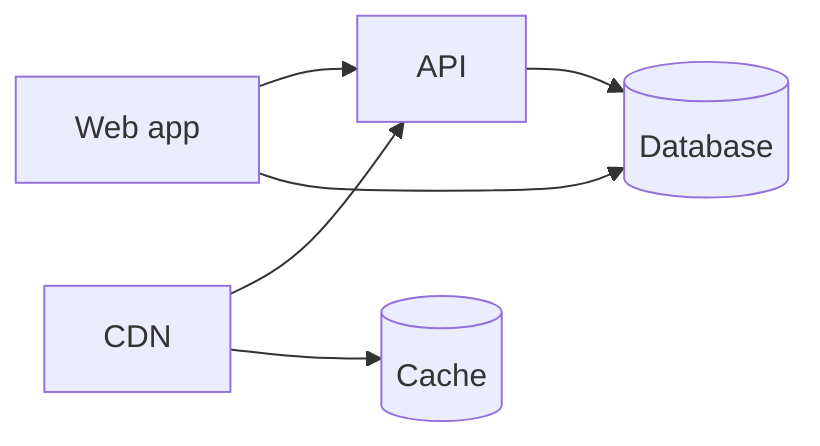

<script setup>
// A web app that reaches the database directly and through the API, and a CDN feeding the API and the cache: one line has to cross another, once.
const graph = `flowchart LR
  Web[Web app] --> Api[API] --> Db[(Database)]
  Web --> Db
  Cdn[CDN] --> Api
  Cdn --> Cache[(Cache)]`
const off = (crossings) => ({ crossings, avoidCrossings: 'off', toolbar: false })
const avoid = (avoidCrossings) => ({ crossings: 'bridge', avoidCrossings, toolbar: false })
</script>

# Edge styles

How Bonkei draws two lines that cross, and how hard it tries to keep them apart. The sample on this page is a web app that reaches the database both directly and through the API, while a CDN feeds the API and the cache: the web app's line to the database has to cross the CDN's lines, once, wherever the nodes are put.

::: code-group
````md [Markdown]

````
```tsx [React]
import { Bonkei } from 'bonkei'

const source = `flowchart LR
  Web[Web app] --> Api[API] --> Db[(Database)]
  Web --> Db
  Cdn[CDN] --> Api
  Cdn --> Cache[(Cache)]`

export const Services = () => (
  <div style={{ height: 420 }}>
    <Bonkei source={source} crossings="bridge" avoidCrossings="off" />
  </div>
)
```
```html [Script tag]
<bonkei-diagram height="420">
  ---
  config:
    bonkei:
      crossings: bridge
      avoidCrossings: off
  ---
  flowchart LR
    Web[Web app] --> Api[API] --> Db[(Database)]
    Web --> Db
    Cdn[CDN] --> Api
    Cdn --> Cache[(Cache)]
</bonkei-diagram>
```
:::

The live diagram, drawn from the Markdown above:


Drag it to turn it; Flat / Iso / 3D and Fit switch the view. It is drawn with `avoidCrossings: off` so the router leaves the one crossing where it is; at the default (`some`) it would move a line to remove it, as [Avoiding crossings](#avoiding-crossings) shows.

## Crossings

When two lines must cross, `crossings` says how the crossing is drawn. The default is `none`: the lines cross as plain lines. The four below are the same diagram with `avoidCrossings: off`, so the router does not move lines out of each other's way and every crossing is there to see.

<div class="grid2">
<BonkeiLive :source="graph" :options="off('none')" :stats="true" :height="300" label="none" />
<BonkeiLive :source="graph" :options="off('bridge')" :stats="true" :height="300" label="bridge" />
<BonkeiLive :source="graph" :options="off('tunnel')" :stats="true" :height="300" label="tunnel" />
<BonkeiLive :source="graph" :options="off('portal')" :stats="true" :height="300" label="portal" />
</div>

Each is set with `avoidCrossings: off`, so the router does not route around the crossing, and the line under it is `onEdgeStats` counting it: see [Counting crossings](#counting-crossings). Turn a diagram to the iso or 3D view to see bridge and tunnel: they lift or dip a line, so from straight above (the flat view) only the portal marks the crossing.

## Avoiding crossings

`avoidCrossings` sets how hard the router keeps lines apart: `off`, `some` (default) or `strong`. Stronger costs routing time when the diagram first draws. The same graph, drawn with bridges, at each level. The line under each is what the router left; on this graph the higher levels slide lines alongside each other rather than remove the crossing, which is why a crossing can be harder to find there.

<div class="grid2">
<BonkeiLive :source="graph" :options="avoid('off')" :stats="true" :height="300" label="off" />
<BonkeiLive :source="graph" :options="avoid('some')" :stats="true" :height="300" label="some" />
<BonkeiLive :source="graph" :options="avoid('strong')" :stats="true" :height="300" label="strong" />
</div>

<div class="table-wrap">

| Option | Values | Default | Frontmatter |
| --- | --- | --- | --- |
| `crossings` | none · bridge · tunnel · portal | none | `config.bonkei.crossings` |
| `avoidCrossings` | off · some · strong | some | `config.bonkei.avoidCrossings` |
| `crossingControls` | true · false | false | `config.bonkei.crossingControls` |

</div>

## Counting crossings

`<Bonkei />` takes `onEdgeStats`, called whenever the lines are planned (a new layout, a drag, a new style). Its `crossings` is how many pairs of lines cross, and `bridge`, `tunnel` and `portal` how many of them were drawn in that style; `skipped` had no room. It is a React prop only; the counts under the diagrams above are this callback. Try the diagram below: drag a node and the count follows.

```tsx twoslash
import { Bonkei } from 'bonkei'

const source = 'flowchart LR\n  A --> D\n  A --> E\n  B --> D\n  B --> E'

export const Counted = () => (
  <div style={{ height: 300 }}>
    <Bonkei source={source} crossings="bridge" avoidCrossings="off" onEdgeStats={s => console.log(`${s.crossings} crossings, ${s.bridge} bridges`)} />
  </div>
)
```

<BonkeiLive :source="graph" :options="{ crossings: 'bridge', avoidCrossings: 'off' }" :stats="true" :height="320" />

## From code

Type-checked against the installed package when the docs build: rename an option and the build fails.

```ts twoslash
import { render, type CrossingStyle, type AvoidCrossings } from 'bonkei'

const crossings: CrossingStyle = 'tunnel'
const avoidCrossings: AvoidCrossings = 'strong'
render(document.body, 'flowchart LR\n  A --> D\n  A --> E\n  B --> D\n  B --> E', { crossings, avoidCrossings })
```

## Letting the reader choose

The toolbar shows the view and Fit. `crossingControls: true` adds the crossing and avoid-crossing groups so the reader can switch them.


