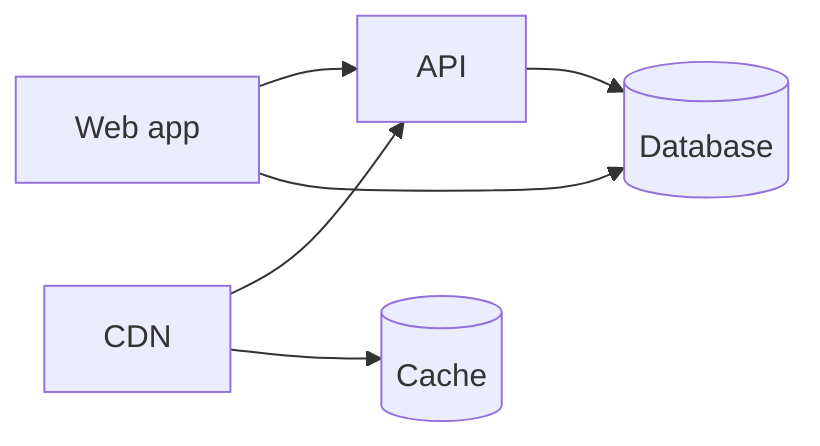

# Edge styles

How Bonkei draws two lines that cross, and how hard it tries to keep them apart. The sample on this page is a web app that reaches the database both directly and through the API, while a CDN feeds the API and the cache: the web app's line to the database has to cross the CDN's lines, once, wherever the nodes are put.

::: code-group
````md [Markdown]

````
```tsx twoslash [React]
import { Bonkei } from 'bonkei'

const source = `flowchart LR
  Web[Web app] --> Api[API] --> Db[(Database)]
  Web --> Db
  Cdn[CDN] --> Api
  Cdn --> Cache[(Cache)]`

export const Services = () => (
  <div style={{ height: 420 }}>
    <Bonkei source={source} crossings="bridge" avoidCrossings="off" />
  </div>
)
```
```html [Script tag]
<bonkei-diagram height="420">
  ---
  config:
    bonkei:
      crossings: bridge
      avoidCrossings: off
  ---
  flowchart LR
    Web[Web app] --> Api[API] --> Db[(Database)]
    Web --> Db
    Cdn[CDN] --> Api
    Cdn --> Cache[(Cache)]
</bonkei-diagram>
```
:::

The live diagram, drawn from the Markdown above:


Drag it to turn it; Flat / Iso / 3D and Fit switch the view. It is drawn with `avoidCrossings: off` so the router leaves the one crossing where it is; at the default (`some`) it would move a line to remove it, as [Avoiding crossings](#avoiding-crossings) shows.

## Crossings

When two lines must cross, `crossings` says how the crossing is drawn. The default is `none`: the lines cross as plain lines. The four below are the same diagram with `avoidCrossings: off`, so the router does not move lines out of each other's way and every crossing is there to see. Each fence carries its own value in its frontmatter. Turn a diagram to the iso or 3D view to see bridge and tunnel: they lift or dip a line, so from straight above (the flat view) only the portal marks the crossing.

<div class="grid2">
<figure>


<figcaption>none</figcaption>
</figure>
<figure>


<figcaption>bridge</figcaption>
</figure>
<figure>


<figcaption>tunnel</figcaption>
</figure>
<figure>


<figcaption>portal</figcaption>
</figure>
</div>

### The trench light

A tunnel is a trench cut into the ground. Classic lights it so it does not read as a dark dip: a soft grey-white light (`#e0e0e0`) along the floor and on the walls, at 30% strength, with no rim. Bonkei and Bonkei · landscape leave the light off, and the tunnel has its dark rim as it always did. Turn a tunnel diagram to iso or 3D to see it. Only the trench is lit; the blocks and lines beside it are not. A diagram with no tunnel looks exactly as it did.

Try it: the controls below set the theme's tokens for this one diagram, and the frontmatter under it shows what they wrote. **Theme default** is what the chosen theme draws on its own; **Light only** is the light out of the floor and nothing else (no wall wash, no rim); **All off** is a tunnel with no light and no rim. The colour and strength change the light: low strength is a thin line along the floor, full strength a bright channel. In Bonkei, tick the floor light and wall wash to see the light there.

<TrenchLight />

Without the controls, this is what they write: **Light only** on Classic gives the demo's diagram this frontmatter.

```yaml
---
config:
  theme: classic
  bonkei:
    crossings: tunnel
    avoidCrossings: off
  themeVariables:
    edge.glow.core: "#e0e0e0"
    edge.glow.halo: "#e0e0e0"
    edge.glow.coreWidth: 2.1
    edge.glow.haloWidth: 6.6
    edge.glow.haloOpacity: 0.17
    edge.glow.wash: null
    edge.rim: none
---
flowchart LR
  Web[Web app] --> Api[API] --> Db[(Database)]
  Web --> Db
  Cdn[CDN] --> Api
  Cdn --> Cache[(Cache)]
```

Each part has its own setting in `config.themeVariables`, so a fence can do the same:

| Setting | Turns off |
| --- | --- |
| `edge.glow: off` | the whole light (floor light and wall wash) |
| `edge.glow.core: null` and `edge.glow.halo: null` | the floor light |
| `edge.glow.wash: null` | the wall wash |
| `edge.rim: none` | the rim |

Any other value is checked: a word `edge.glow` does not know, a colour that is not a string, or a negative width is skipped, the diagram draws with the theme's own light, and [`onWarning`](./errors) reports it.

A diagram can also set its own rim, and the diagram's value wins over the theme's. This diagram sets a thin teal rim with `edge.rim` and `edge.rimWidth`, instead of the theme's dark rim:


The other parts are tokens too: `edge.glow.core`, `edge.glow.coreWidth`, `edge.glow.halo`, `edge.glow.haloWidth`, `edge.glow.haloOpacity`, `edge.glow.wash` and `edge.glow.washIntensity`. See [Themes](./themes#the-trench-light).

## Avoiding crossings

`avoidCrossings` sets how hard the router keeps lines apart: `off`, `some` (default) or `strong`. Stronger costs routing time when the diagram first draws. The same graph, drawn with bridges, at each level. On this graph the higher levels slide lines alongside each other rather than remove the crossing, which is why a crossing can be harder to find there.

<div class="grid2">
<figure>


<figcaption>off</figcaption>
</figure>
<figure>


<figcaption>some</figcaption>
</figure>
<figure>


<figcaption>strong</figcaption>
</figure>
</div>

<div class="table-wrap">

| Option | Values | Default | Frontmatter |
| --- | --- | --- | --- |
| `crossings` | none · bridge · tunnel · portal | none | `config.bonkei.crossings` |
| `avoidCrossings` | off · some · strong | some | `config.bonkei.avoidCrossings` |
| `crossingControls` | true · false | false | `config.bonkei.crossingControls` |

</div>

## Counting crossings

`<Bonkei />` takes `onEdgeStats`, called whenever the lines are planned (a new layout, a drag, a new style). Its `crossings` is how many pairs of lines cross, and `bridge`, `tunnel` and `portal` how many of them were drawn in that style; `skipped` had no room. It is a React prop only; the line under each diagram below is this callback. On this site a fence with `{stats}` shows it. Drag a node and the count follows.

```tsx twoslash
import { Bonkei } from 'bonkei'

const source = 'flowchart LR\n  A --> D\n  A --> E\n  B --> D\n  B --> E'

export const Counted = () => (
  <div style={{ height: 300 }}>
    <Bonkei source={source} crossings="bridge" avoidCrossings="off" onEdgeStats={s => console.log(`${s.crossings} crossings, ${s.bridge} bridges`)} />
  </div>
)
```

<div class="grid2">
<figure>


<figcaption>none</figcaption>
</figure>
<figure>


<figcaption>bridge</figcaption>
</figure>
<figure>


<figcaption>tunnel</figcaption>
</figure>
<figure>


<figcaption>portal</figcaption>
</figure>
</div>

## From code

Type-checked against the installed package when the docs build: rename an option and the build fails.

```ts twoslash
import { render, type CrossingStyle, type AvoidCrossings } from 'bonkei'

const crossings: CrossingStyle = 'tunnel'
const avoidCrossings: AvoidCrossings = 'strong'
render(document.body, 'flowchart LR\n  A --> D\n  A --> E\n  B --> D\n  B --> E', { crossings, avoidCrossings })
```

## Letting the reader choose

The toolbar shows the view and Fit. `crossingControls: true` adds the crossing and avoid-crossing groups so the reader can switch them.


