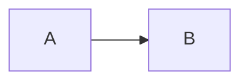
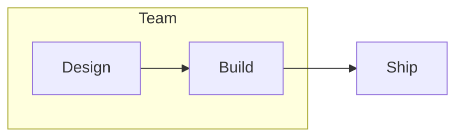

# Errors and warnings

Two kinds of problem, and three more events.

- **Error** (`BonkeiError`): nothing could be drawn. Bonkei shows a card in the diagram's place and calls `onError` with a `kind` (`parse`, `graph`, `layout` or `render`), a `message` and, when it knows, the `line`.
- **Warning** (`BonkeiWarning`): the diagram is drawn despite the problem. A source line it could not use (`dropped`), a bad frontmatter key (`frontmatter`), an unknown theme or theme variable (`theme`). `onWarning` gets the `line` and the text.

## An error

A diagram that cannot be parsed:

```mermaid {events height=200}
flowchart TD
  --> -->
```

## A warning

The first line the parser cannot use is dropped and the rest draws. Here the frontmatter holds an option Bonkei does not have:



## onReady, onNodeClick and onModeChange

`onReady` fires once a new source's first frame is drawn, with the layout time and counts. `onNodeClick` fires for a node, a group or a sequence participant. `onModeChange` fires when the view changes, and says who changed it: the `toolbar`, the `handle`, or a changed `prop`. Click a node and switch the view:



## From code

```ts twoslash
import { render, isBonkeiError, type BonkeiError, type BonkeiWarning, type NodeClick, type ReadyInfo } from 'bonkei'

render(document.body, 'flowchart LR\n  A --> B', {
  onError: (e: BonkeiError) => console.error(e.kind, e.line, e.message),
  onWarning: (w: BonkeiWarning) => console.warn(w.kind, w.line, w.message),
  onReady: (r: ReadyInfo) => console.log(r.nodes, r.edges, r.layoutMs),
  onNodeClick: (n: NodeClick) => console.log(n.kind, n.id, n.label),
  onModeChange: (mode, change) => console.log(mode, change.source),
})

try { throw new Error('x') } catch (e) { if (isBonkeiError(e)) console.log(e.kind) }
```

## In the other ways in

The script tag's `<bonkei-diagram>` fires a `bonkei-error` event with `detail.kind` and `detail.message`, and `bonkei-ready` when drawn. In VitePress a diagram that fails shows the card in place, and the plugin's `onFence` reports each fence at build time.
