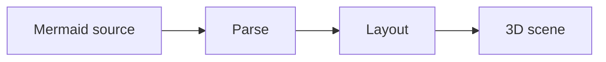

# Introduction

Bonkei draws [Mermaid](https://mermaid.js.org) diagrams as 3D scenes. The reader can turn a diagram by dragging it, switch between flat, isometric and 3D views, and drill into groups. You write ordinary Mermaid; Bonkei does the drawing.



This diagram is live. Sample data: every diagram on this site is made up.

## Try it

Edit the Mermaid on the left; the diagram on the right follows.

<BonkeiPlayground :height="320" source="sequenceDiagram
  participant U as User
  participant A as App
  U->>A: Edit the text
  A-->>U: The diagram changes" />

## Pick your way in

| You have | Read | You write |
| --- | --- | --- |
| A React app | [React](./react) | `<Bonkei source={…} />` |
| Any page, with a bundler | [Plain JavaScript](./javascript) | `render(element, source)` |
| A page with no build step | [Script tag](./script-tag) | `<bonkei-diagram>` |
| A VitePress site | [VitePress](./vitepress) | a ` ```mermaid ` fence |

All four draw the same diagram. The options on [Options and frontmatter](./options) work in all of them.

## What Bonkei draws

Flowcharts and sequence diagrams. Any other Mermaid type is left alone: see [Diagram types](./diagram-types).

## Read these docs with an agent

Every page here is also plain Markdown. [`/docs/llms.txt`](/llms.txt) lists the pages, [`/docs/llms-full.txt`](/llms-full.txt) holds them all in one file, and a page's Markdown is at its address plus `.md`. Each page has a **Copy page** button.

The examples run against the real package: this site installs `bonkei` and `@bonkei/vitepress` from their packed tarballs, the way your app will, and every code sample is type-checked against them when the docs build.
