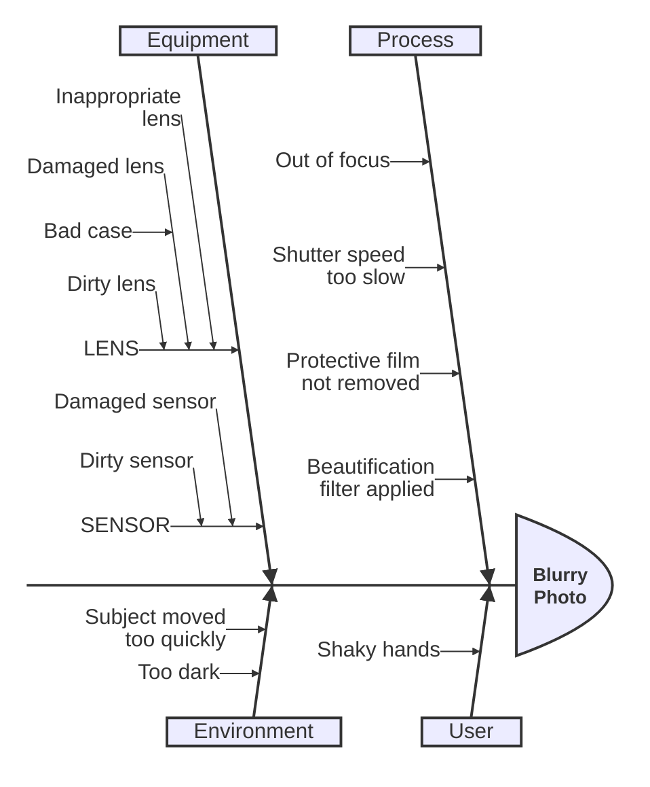
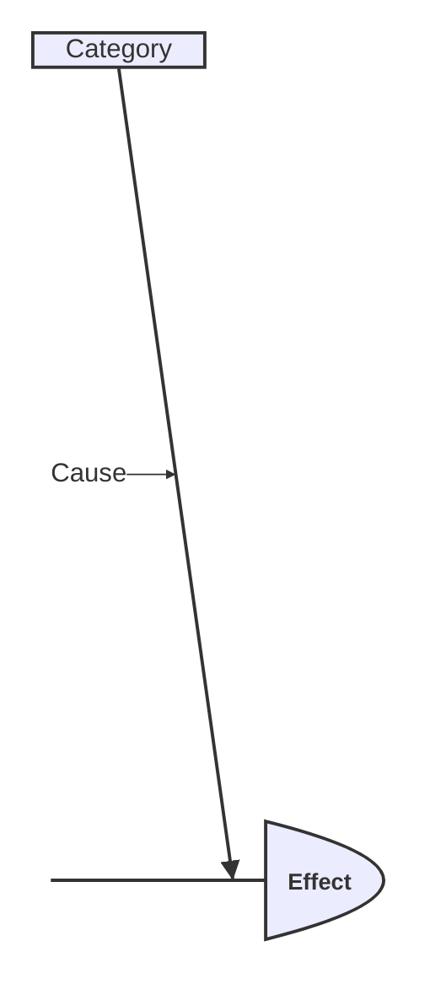

# Ishikawa (fishbone) diagrams

Write the text Mermaid reads (`ishikawa-beta`, or `ishikawa`). The first line after the keyword is the **effect**, drawn as a fish's head at the end of the spine. Lines at its indent are **categories**, the bones; deeper lines are **causes**, at any depth.

Categories follow Mermaid's order: the first are nearest the head, alternating top and bottom. Every line ends in an arrowhead where it joins what it causes, and the causes of a cause hang on the far side of their parent's line.

## What is skipped

A line Bonkei cannot read (a tab in the indentation, a line indented less than the effect) is skipped with a warning that names its line, the same as for flowcharts (see [errors](./errors)); the rest is drawn. A diagram with only the keyword warns and draws nothing.

## Try your own

