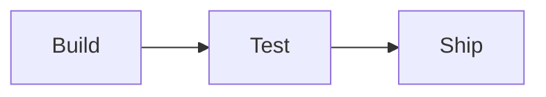

# Plain JavaScript

For any page you bundle yourself, without React in your code.

```sh
npm install bonkei react react-dom three
```

`render()` owns its own React root. You never see React.

::: code-group
```ts twoslash [JavaScript]
import { render } from 'bonkei'

const el = document.getElementById('diagram')!
el.style.height = '360px'
const diagram = render(el, 'flowchart LR\n  Build --> Test --> Ship', { mode: 'iso' })

diagram.update('flowchart LR\n  Build --> Test --> Ship --> Monitor') // new source, the view stays where it is
diagram.setTheme('bonkei')                                           // new theme, the view stays where it is
diagram.setMode('flat')
diagram.fit()
// diagram.destroy() // unmounts the diagram; later calls do nothing
```
````md [Markdown]

````
```html [Script tag]
<script src="bonkei.global.js"></script>
<div id="diagram" style="height: 360px"></div>
<script>Bonkei.render(document.getElementById('diagram'), 'flowchart LR\n  Build --> Test --> Ship')</script>
```
:::

Live, drawn with `render()`:


## The handle

`render()` returns a `BonkeiHandle`: `update(source)`, `setTheme(theme)`, `setMode(mode)`, `fit()` and `destroy()`. A failed `update` keeps the last diagram. `setTheme` takes a preset name or a `Theme`, or `undefined` to go back to the frontmatter's theme (or the default).

Only the first draw frames the diagram. After that a new layout (a new source, a new theme, another Avoid crossings level) leaves the view where the reader put it: the same position, zoom and angle, and the same tray if they had flown into one. What is on screen stays put on screen even where the diagram grows or shrinks around it; something added out of view stays out of view until the reader moves there or presses Fit. `fit()`, `setMode()` and Flat / Iso / 3D frame the diagram as before; if the tray the reader was in has been deleted, the next of those frames the nearest tray that held it, or the whole diagram.

## A graph you build by hand

`source` can also be a `GraphInput` instead of Mermaid text.

```ts twoslash
import { render, type GraphInput } from 'bonkei'

const graph: GraphInput = {
  nodes: [{ id: 'a', label: 'Client', shape: 'rect' }, { id: 'b', label: 'API', shape: 'round' }],
  edges: [{ id: 'e1', from: 'a', to: 'b' }],
}
render(document.body, graph)
```

Next: [Options and frontmatter](./options).
