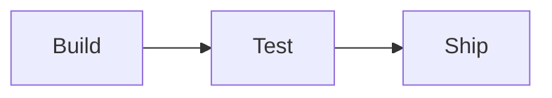

# Plain JavaScript

For any page you bundle yourself, without React in your code.

```sh
npm install bonkei react react-dom three
```

`render()` owns its own React root. You never see React.

::: code-group
```ts twoslash [JavaScript]
import { render } from 'bonkei'

const el = document.getElementById('diagram')!
el.style.height = '360px'
const diagram = render(el, 'flowchart LR\n  Build --> Test --> Ship', { mode: 'iso' })

diagram.update('flowchart LR\n  Build --> Test --> Ship --> Monitor') // same view, new source
diagram.setMode('flat')
diagram.fit()
// diagram.destroy() // unmounts the diagram; later calls do nothing
```
````md [Markdown]

````
```html [Script tag]
<script src="bonkei.global.js"></script>
<div id="diagram" style="height: 360px"></div>
<script>Bonkei.render(document.getElementById('diagram'), 'flowchart LR\n  Build --> Test --> Ship')</script>
```
:::

Live, drawn with `render()`:


## The handle

`render()` returns a `BonkeiHandle`: `update(source)`, `setMode(mode)`, `fit()` and `destroy()`. A failed `update` keeps the last diagram.

## A graph you build by hand

`source` can also be a `GraphInput` instead of Mermaid text.

```ts twoslash
import { render, type GraphInput } from 'bonkei'

const graph: GraphInput = {
  nodes: [{ id: 'a', label: 'Client', shape: 'rect' }, { id: 'b', label: 'API', shape: 'round' }],
  edges: [{ id: 'e1', from: 'a', to: 'b' }],
}
render(document.body, graph)
```

Next: [Options and frontmatter](./options).
