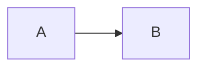
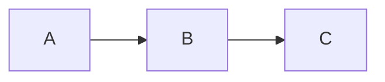
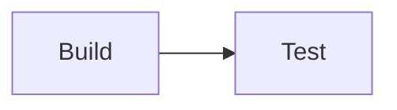
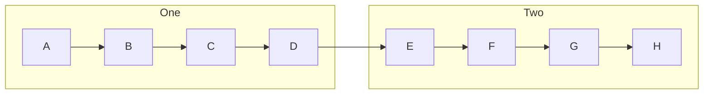

# Options and frontmatter

An option can come from three places. The nearest wins: a prop (or fence attribute) over the diagram's frontmatter, and the frontmatter over the default.

````md

````


## The table

<div class="table-wrap">

| Option | Values | Default | Frontmatter key |
| --- | --- | --- | --- |
| `mode` | `flat` · `iso` · `3d` | `iso` | `config.bonkei.mode` |
| `labels` | `top` · `billboard` | `top` | `config.bonkei.labels` |
| `toolbar` | `true` · `false` | `true` | `config.bonkei.toolbar` |
| `controls` | `true` · `false` · per control | `true` | `config.bonkei.controls` |
| `crossings` | `none` · `bridge` · `tunnel` · `portal` | `none` | `config.bonkei.crossings` |
| `avoidCrossings` | `off` · `some` · `strong` | `some` | `config.bonkei.avoidCrossings` |
| `crossingControls` | `true` · `false` | `false` | `config.bonkei.crossingControls` |
| `fit` | `default` · `tight` | `default` | prop only |
| `minLabelPx` | a number of pixels, `0` is off | `0` | prop only |
| `theme` | a theme name or a `Theme` | `classic` | `config.theme` |

</div>

`controls`, `crossings`, `avoidCrossings` and `crossingControls` have their own pages: [The reader's controls](./controls) and [Edge styles](./edge-styles). `theme` is on [Themes](./themes).

## mode

The starting view. The reader can change it with the toolbar.

<div class="grid4">




</div>

<p class="cap">flat · iso · 3d</p>

## labels

Where labels sit: `top` (on top of the shapes) or `billboard` (turned towards the camera).

<div class="grid4">




</div>

<p class="cap">top · billboard</p>

## toolbar

The toolbar shows the view (Flat, Iso, 3D) and Fit. `toolbar: false` removes it; the reader can still turn the diagram by hand. The diagram above this section's table is the example.

## fit and minLabelPx

`fit: 'tight'` frames the diagram's real extent with a small margin. `minLabelPx` opens zoomed in on the largest tray when the whole diagram would make node labels smaller than that many pixels, which suits a phone. Both are props. On this site a fence can pass them as attributes, like `{fit=tight}`, so these examples stay ordinary `mermaid` fences in the page's Markdown; the plain VitePress plugin ignores those two attributes.

`fit` side by side, the same diagram: `default` leaves generous margins, `tight` fills the box with the diagram's real extent.

<div class="grid2">
<figure>


<figcaption>fit: 'default'</figcaption>
</figure>
<figure>


<figcaption>fit: 'tight'</figcaption>
</figure>
</div>

`minLabelPx`, on a diagram too wide for its labels to be readable at once: it opens zoomed in on the largest tray.



## From code

```ts twoslash
import { render, type BonkeiOptions } from 'bonkei'

const options: BonkeiOptions = { mode: 'flat', labels: 'billboard', toolbar: false, fit: 'tight', minLabelPx: 12, theme: 'bonkei' }
render(document.body, 'flowchart LR\n  A --> B', options)
```

A bad frontmatter value never stops the diagram: it is reported through [`onWarning`](./errors) and the default is used.
