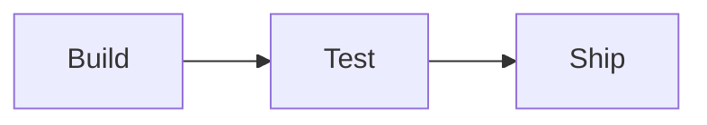

# React

```sh
npm install bonkei react react-dom three
```

`react`, `react-dom` and `three` are peer dependencies, so your app keeps one copy of each.

## Draw a diagram

`<Bonkei />` fills its container, so give the container a height.

::: code-group
```tsx twoslash [React]
import { Bonkei } from 'bonkei'

export function Pipeline() {
  return (
    <div style={{ height: 360 }}>
      <Bonkei source={'flowchart LR\n  Build --> Test --> Ship'} />
    </div>
  )
}
```
````md [Markdown]

````
```html [Script tag]
<bonkei-diagram height="360">
  flowchart LR
    Build --> Test --> Ship
</bonkei-diagram>
```
:::

The result, drawn by the same package:


## Props

`<Bonkei />` takes `source` and every [option](./options), plus the [events](./errors). A prop wins over the same key in the diagram's frontmatter.

```tsx twoslash
import { Bonkei } from 'bonkei'

export const Quiet = () => (
  <div style={{ height: 300 }}>
    <Bonkei source={'flowchart TD\n  A --> B'} mode="flat" toolbar={false} controls={{ zoom: false }} theme="bonkei" />
  </div>
)
```

## The ref handle

A ref gives `setMode()` and `fit()`.

```tsx twoslash
import { useRef } from 'react'
import { Bonkei, type BonkeiViewHandle } from 'bonkei'

export function WithButtons() {
  const view = useRef<BonkeiViewHandle>(null)
  return (
    <>
      <button onClick={() => view.current?.setMode('3d')}>3D</button>
      <button onClick={() => view.current?.fit()}>Fit</button>
      <div style={{ height: 300 }}><Bonkei ref={view} source={'flowchart LR\n  A --> B'} /></div>
    </>
  )
}
```

Try it here: the same handle drives this live diagram through `render()`.

<BonkeiLive :height="260" :events="true" source="flowchart LR
  Draw --> Turn --> Fit" />

Next: [Options and frontmatter](./options).
