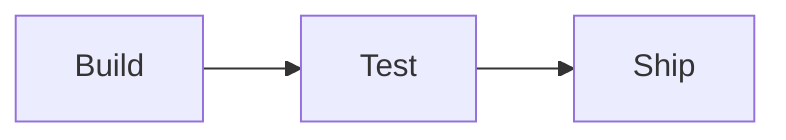

# Script tag

For a page with no build step: three things to copy next to your HTML, one `<script>`, and the `<bonkei-diagram>` element.

## Get the files

```sh
npm install bonkei
cp node_modules/bonkei/dist/bonkei.global.js node_modules/bonkei/dist/libavoid.wasm public/
cp -r node_modules/bonkei/dist/fonts public/
```

Serve `bonkei.global.js`, `libavoid.wasm` and `fonts/` from the same folder. The script finds the other two beside itself. Until Bonkei is on npm, these docs serve the same three files from the package they installed: [`bonkei.global.js`](/bonkei/bonkei.global.js), [`libavoid.wasm`](/bonkei/libavoid.wasm), `fonts/`.

## Write a page

::: code-group
```html [Script tag]
<script src="bonkei.global.js"></script>

<bonkei-diagram height="360">
  flowchart LR
    Build --> Test --> Ship
</bonkei-diagram>
```
````md [Markdown]

````
```tsx [React]
import { Bonkei } from 'bonkei'
<div style={{ height: 360 }}><Bonkei source={'flowchart LR\n  Build --> Test --> Ship'} /></div>
```
:::

The text inside the element is the diagram. A `<` or `&` in a label is written `&lt;` or `&amp;`, as in any HTML. Below is a real `<bonkei-diagram>` element, drawn by the script from these docs:

<ScriptTagDemo :height="360" source="flowchart LR
  Build --> Test --> Ship" />

Attributes: `mode` (`flat`, `iso`, `3d`), `theme`, `height`. See [Script tag element](/reference/script-tag).

## Mermaid blocks you already have

`Bonkei.run()` converts `<pre class="mermaid">` blocks that hold a flowchart or a sequence diagram. It is opt-in and never automatic.

```html
<script>Bonkei.run({ querySelector: 'pre.mermaid' })</script>
```

Blocks of other types stay as they were.
