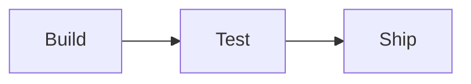
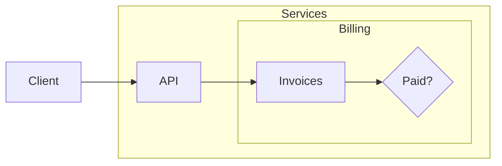
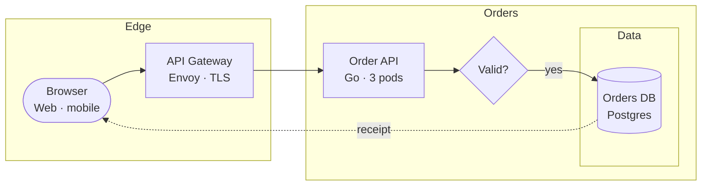
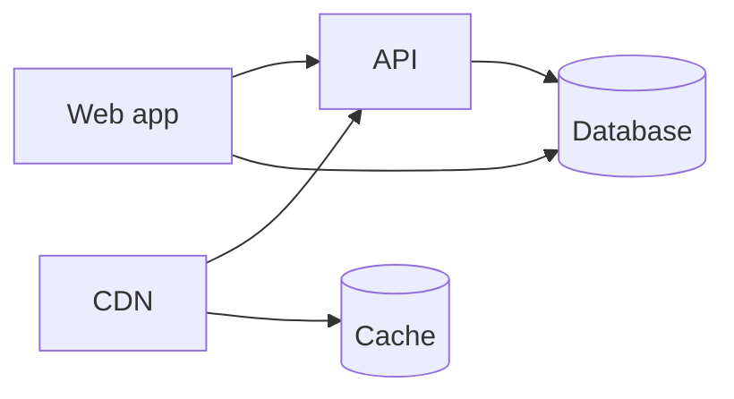

# Themes

A theme is data: every colour, material, label and line style the scene reads. Five ship with Bonkei, named by `THEME_NAMES`: `classic`, `bonkei`, `bonkei-landscape`, `blueprint` and `cloud-cartography`. `classic` is the default.

<div class="grid4">




</div>

<p class="cap">classic · bonkei · bonkei-landscape · blueprint</p>

## Choosing a theme

::: code-group
````md [Markdown]

````
```ts twoslash [React / JavaScript]
import { render, THEME_NAMES, BONKEI } from 'bonkei'

render(document.body, 'flowchart LR\n  A --> B', { theme: 'bonkei' }) // by name
render(document.body, 'flowchart LR\n  A --> B', { theme: { ...BONKEI, name: 'mine' } }) // or a whole Theme
console.log(THEME_NAMES)
```
```html [Script tag]
<bonkei-diagram theme="bonkei">
  flowchart LR
    Build --> Test --> Ship
</bonkei-diagram>
```
:::

In frontmatter it is Mermaid's own key: `config.theme: bonkei`.

## Changing one thing

`config.themeVariables` lays single tokens over the theme, by dotted path. `node.form: landscape` stands a landscape form on each node.


A name that does not exist falls back to `classic` and reports a warning through [`onWarning`](./errors); so does a variable that does not exist.

### Blueprint

`blueprint` draws an architect's drawing: blue paper with a fine grid and a heavier line every 5 squares, white outlines and pale-blue lines, flat shading, hatched tray sides, and labels in a hand-lettering font (Architects Daughter, bundled like the Bonkei themes' font; if the file cannot be loaded the labels use the default font and [`onWarning`](./errors) says why).

Each tray's title sits off the tray, in a coloured-in box on the surface just in front of it: on the paper for a top tray, on its parent's top for a tray inside another. The layout leaves room for it there, so a Blueprint diagram is laid out a little more spaciously than the same diagram in the other themes, and no line runs over a title. A long title in a narrow tray is drawn smaller to fit its box.



Its parts are tokens like any other, so another theme can borrow one:

| Token | What it is |
| --- | --- |
| `ground.major`, `ground.majorColor` | A heavier grid line every this many squares, and its colour. `0` (every other theme) is a single-weight grid. |
| `tray.sides.0`, `.1`, `.2` | `hatch`: diagonal section hatching on the tray's sides (by nesting depth), beside `plain`, `hishi`, `flower` and `stone`. |
| `tray.titles` | `off`: the title in a box in front of the tray, with room made for it in the layout; `fixed` and `free` keep it on the tray. |
| `label.font` | `architect`: the hand lettering; `mincho` is the Bonkei themes' font. |

### Cloud Cartography

`cloud-cartography` draws a diagram like an illustrated map of a system. Each top-level subgraph is a coloured floor (green, orange, grey, blue, then round again) with its name in big capitals lying on it, front-left; a subgraph inside another is a stronger tint of its parent's colour. Each node is an outlined icon chosen by its shape, modelled so it turns with the view: a server for `[rect]`, a hex puck for `(round)`, a stack of discs for `[(cylinder)]` and a pyramid for `{diamond}`. Its label sits on a callout card above it, on a dotted leader. Links are navy lines on the floor with one arrow partway along and none at the end, and their labels sit on pills.

Two things written in plain Mermaid read differently here, and only here:

- A label written over two lines, `A["Order API<br>Go · 3 pods"]`, shows **Order API** in bold on the card and *Go · 3 pods* smaller and grey beneath. A one-line label is the name alone. The other themes still read it on one line, `Order API Go · 3 pods`.
- A dotted link, `A -.-> B`, arcs overhead as a dashed line with an arrowhead at its target, and takes no part in the layout (it does not push the nodes about, and no line is routed round it). The other themes draw it as any link. Mermaid itself draws the same source as it always does.

The zone names and the card names are lettered in Archivo Black (SIL OFL, bundled, fetched only when this theme draws); if the file cannot be loaded they use the default font and [`onWarning`](./errors) says why. The layout leaves a strip at the bottom of every tray for its name, so a diagram is a little taller than in Classic.



A sequence diagram draws too: each participant is an icon under its card, with its lifeline on the floor.

Its parts are tokens like any other:

| Token | What it is |
| --- | --- |
| `node.form` | `icon`: an outlined icon by shape, beside `block` and `landscape`. `node.icon.side` is the icons' body colour, `node.icon.size` the footprint they fill. |
| `label.node.style`, `label.card` | `card`: the callout card. `label.card.sub` is the subtitle's colour, `.leader` the leader's (`null`: no leader), `.gap` the card's lift above the icon, `.titleFont` the name's font. |
| `label.pill` | A link label on a pill of this colour; `null` (every other theme): bare text. |
| `tray.titles` | `ground`: the name in big capitals lying on the floor, with room made for it; `tray.groundFont` its font, `tray.groundInk` how much darker than the floor it is. |
| `tray.colorBy`, `tray.zones`, `tray.zoneMix` | `zone`: each top-level tray takes the next colour of `tray.zones`, mixed with white by `tray.zoneMix` (top-level, nested); `level` (every other theme) colours trays by depth. `tray.radius` rounds the floor's corners. |
| `edge.arrow` | `mid`: one arrow partway along the line, none at its end; `end` (every other theme): an arrowhead at the end. |
| `edge.dotted`, `edge.arc` | `arc`: a dotted link as a dashed arc overhead (`edge.arc.color`, `.width`, `.peak` as a share of its span, `.arrow` the arrowhead's length); `line` (every other theme): drawn as any link. |

So a Cloud Cartography diagram can keep its dotted links on the ground with `themeVariables: { edge.dotted: line }`.

### The trench light

A tunnel's trench can be lit by the theme: a light along the floor, a wash on the walls and a rim round the lip. What each theme does on its own:

| Theme | Floor light and wall wash | Rim |
| --- | --- | --- |
| `classic` | On: grey-white `#e0e0e0` at 30% strength (core 2.1 wide; halo 6.6 wide at 0.17 opacity; wash intensity 0.18) | None (`edge.rim: none`) |
| `bonkei`, `bonkei-landscape` | Off (the colours are `null`) | Dark `#2A2622`, 2 wide, as it always was |
| `blueprint` | On: pale blue `#bfe4ff` at 50% strength | Pale blue `#bcdcff`, 1.5 wide |
| `cloud-cartography` | No trench: its lines lie flat on the floor (`edge.flat`), so a tunnel is drawn level | None |

A diagram can change any part, so a Bonkei diagram can switch its light on, or a Classic one put a rim back:

| Token | What it is |
| --- | --- |
| `edge.rim`, `edge.rimWidth` | The rim round the lip: its colour and width. `none` draws no rim; `null` is a dark shade of the surface. Any other word that is not a colour is reported and the theme's rim kept. |
| `edge.glow` | `off` (or `false`) turns the floor light and the wall wash off. |
| `edge.glow.core`, `edge.glow.coreWidth` | The bright line along the floor. `null` leaves it out. |
| `edge.glow.halo`, `edge.glow.haloWidth`, `edge.glow.haloOpacity` | The soft, wider glow round that line; it also lights the walls from the floor up, fading to nothing at the lip, so the floor light shows where the floor itself is hidden (as in iso). `null` leaves it out. |
| `edge.glow.wash`, `edge.glow.washIntensity` | The faint light on the trench walls. `null` leaves it out. |



[Edge styles](./edge-styles#the-trench-light) has controls to try each part, and a diagram with its own rim.

## The theme objects

`CLASSIC`, `BONKEI`, `BONKEI_LANDSCAPE` and `BLUEPRINT` are frozen `Theme` objects, for passing as `theme` or as a base to copy and edit. Their fields are in the [Theme](/api/interfaces/Theme) reference.
