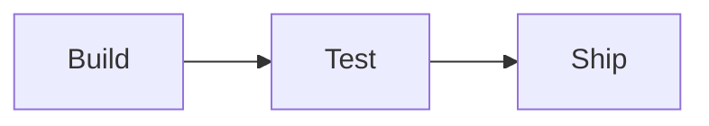
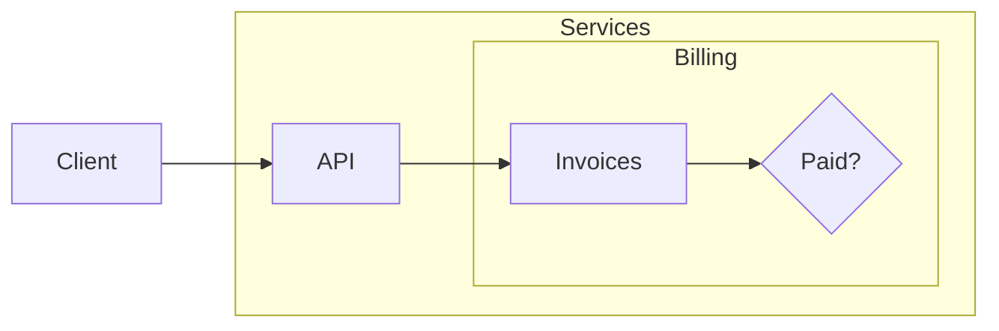
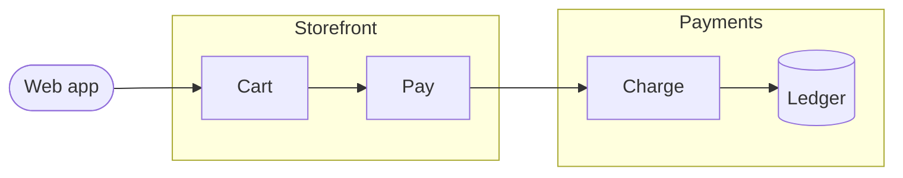
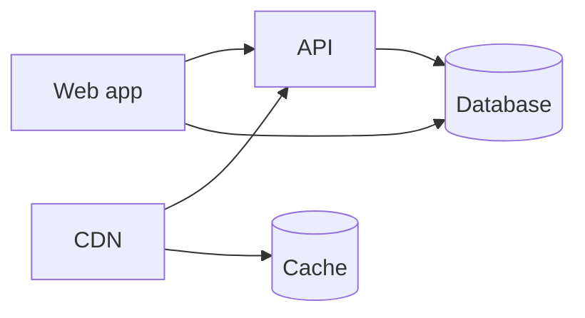

# Themes

A theme is data: every colour, material, label and line style the scene reads. Five ship with Bonkei, named by `THEME_NAMES`: `classic`, `bonkei`, `bonkei-landscape`, `blueprint` and `ltech`. `classic` is the default.

<div class="grid4">




</div>

<p class="cap">classic · bonkei · bonkei-landscape · blueprint · ltech</p>

## Choosing a theme

::: code-group
````md [Markdown]

````
```ts twoslash [React / JavaScript]
import { render, THEME_NAMES, BONKEI } from 'bonkei'

render(document.body, 'flowchart LR\n  A --> B', { theme: 'bonkei' }) // by name
render(document.body, 'flowchart LR\n  A --> B', { theme: { ...BONKEI, name: 'mine' } }) // or a whole Theme
console.log(THEME_NAMES)
```
```html [Script tag]
<bonkei-diagram theme="bonkei">
  flowchart LR
    Build --> Test --> Ship
</bonkei-diagram>
```
:::

In frontmatter it is Mermaid's own key: `config.theme: bonkei`.

## Changing one thing

`config.themeVariables` lays single tokens over the theme, by dotted path. `node.form: landscape` stands a landscape form on each node.


A name that does not exist falls back to `classic` and reports a warning through [`onWarning`](./errors); so does a variable that does not exist.

### Blueprint

`blueprint` draws an architect's drawing: blue paper with a fine grid and a heavier line every 5 squares, white outlines and pale-blue lines, flat shading, hatched tray sides, and labels in a hand-lettering font (Architects Daughter, bundled like the Bonkei themes' font; if the file cannot be loaded the labels use the default font and [`onWarning`](./errors) says why).

Each tray's title sits off the tray, in a coloured-in box on the surface just in front of it: on the paper for a top tray, on its parent's top for a tray inside another. The layout leaves room for it there, so a Blueprint diagram is laid out a little more spaciously than the same diagram in the other themes, and no line runs over a title. A long title in a narrow tray is drawn smaller to fit its box.



Its parts are tokens like any other, so another theme can borrow one:

| Token | What it is |
| --- | --- |
| `ground.major`, `ground.majorColor` | A heavier grid line every this many squares, and its colour. `0` (every other theme) is a single-weight grid. |
| `tray.sides.0`, `.1`, `.2` | `hatch`: diagonal section hatching on the tray's sides (by nesting depth), beside `plain`, `hishi`, `flower` and `stone`. |
| `tray.titles` | `off`: the title in a box in front of the tray, with room made for it in the layout; `fixed` and `free` keep it on the tray. |
| `label.font` | `architect`: the hand lettering; `mincho` is the Bonkei themes' font. |

### LTech

`ltech` is the look of [lazertechnologies.com](https://www.lazertechnologies.com/) as it is today, a light site: a white ground with a faint dot grid and a soft pink haze at the left and right edges of the view, navy line work and lettering in a grotesk (Inter Display, bundled the same way as the other fonts, with the same fallback), flat shading, and hot pink kept to small marks: the arrowheads, a square before each tray's title, activations, portals and a tunnel's lip. Nothing glows (the trench light is off). Rounded shapes are the site's black button with a white label. Each tray's title reads like the site's section labels, `01 · STOREFRONT`, numbered in reading order, and the tray sides carry the footer's pixel dither: grey pixels thinning towards the top with pink ones scattered near the lip. It is drawn without Lazer's own font, logo or wordmark.



Its parts are tokens like any other, so another theme can borrow one (each is off in the other themes):

| Token | What it is |
| --- | --- |
| `ground.gridStyle` | `dots`: a dot on every crossing of the grid, in the grid's first colour, in place of `lines`. |
| `ground.haze`, `ground.hazeWidth` | A colour washed over the ground at the left and right edges of the view, and how far in it reaches (0 to 1 of the width). It follows the picture's edges, not the diagram; `null` is none. |
| `edge.head`, `edge.headColor` | `chevron`: an open chevron in place of the cone, on flowchart edges and sequence messages, in `headColor` (`null`: the line's colour). |
| `tray.titleStyle`, `tray.mark` | `section`: a small square in `mark`, then the number and the name in capitals. `plain` is the title as written. |
| `tray.sides.0`, `.1`, `.2` | `dither`: the pixel dither on the tray's sides. Its pink pixels are `tray.mark`. |
| `label.shapeText.rect`, `.round`, `.cylinder`, `.diamond` | A label colour for the nodes of one shape (a white name on a black fill); `null` keeps the node label colour. |
| `seq.partFill`, `seq.partText` | A sequence participant's fill and name colour; `null` keeps the node's. |
| `label.font` | `inter`: Inter Display, beside `mincho` and `architect`. |

### The trench light

A tunnel's trench can be lit by the theme: a light along the floor, a wash on the walls and a rim round the lip. What each theme does on its own:

| Theme | Floor light and wall wash | Rim |
| --- | --- | --- |
| `classic` | On: grey-white `#e0e0e0` at 30% strength (core 2.1 wide; halo 6.6 wide at 0.17 opacity; wash intensity 0.18) | None (`edge.rim: none`) |
| `bonkei`, `bonkei-landscape` | Off (the colours are `null`) | Dark `#2A2622`, 2 wide, as it always was |
| `blueprint` | On: pale blue `#bfe4ff` at 50% strength | Pale blue `#bcdcff`, 1.5 wide |
| `ltech` | Off (no glow) | Pink `#ff42e6`, 1.5 wide |

A diagram can change any part, so a Bonkei diagram can switch its light on, or a Classic one put a rim back:

| Token | What it is |
| --- | --- |
| `edge.rim`, `edge.rimWidth` | The rim round the lip: its colour and width. `none` draws no rim; `null` is a dark shade of the surface. Any other word that is not a colour is reported and the theme's rim kept. |
| `edge.glow` | `off` (or `false`) turns the floor light and the wall wash off. |
| `edge.glow.core`, `edge.glow.coreWidth` | The bright line along the floor. `null` leaves it out. |
| `edge.glow.halo`, `edge.glow.haloWidth`, `edge.glow.haloOpacity` | The soft, wider glow round that line; it also lights the walls from the floor up, fading to nothing at the lip, so the floor light shows where the floor itself is hidden (as in iso). `null` leaves it out. |
| `edge.glow.wash`, `edge.glow.washIntensity` | The faint light on the trench walls. `null` leaves it out. |



[Edge styles](./edge-styles#the-trench-light) has controls to try each part, and a diagram with its own rim.

## The theme objects

`CLASSIC`, `BONKEI`, `BONKEI_LANDSCAPE`, `BLUEPRINT` and `LTECH` are frozen `Theme` objects, for passing as `theme` or as a base to copy and edit. Their fields are in the [Theme](/api/interfaces/Theme) reference.
