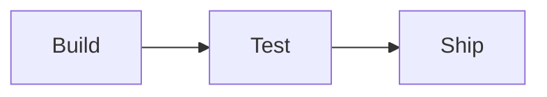
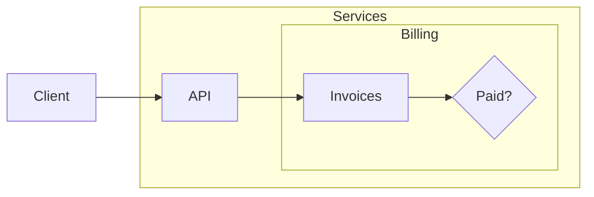
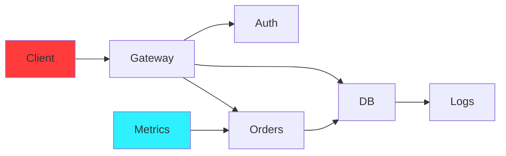
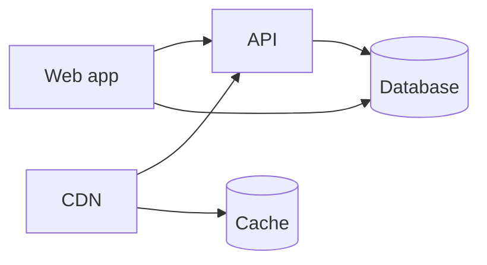

# Themes

A theme is data: every colour, material, label and line style the scene reads. Five ship with Bonkei, named by `THEME_NAMES`: `classic`, `bonkei`, `bonkei-landscape`, `blueprint` and `lazers`. `classic` is the default.

<div class="grid4">




</div>

<p class="cap">classic · bonkei · bonkei-landscape · blueprint · lazers</p>

## Choosing a theme

::: code-group
````md [Markdown]

````
```ts twoslash [React / JavaScript]
import { render, THEME_NAMES, BONKEI } from 'bonkei'

render(document.body, 'flowchart LR\n  A --> B', { theme: 'bonkei' }) // by name
render(document.body, 'flowchart LR\n  A --> B', { theme: { ...BONKEI, name: 'mine' } }) // or a whole Theme
console.log(THEME_NAMES)
```
```html [Script tag]
<bonkei-diagram theme="bonkei">
  flowchart LR
    Build --> Test --> Ship
</bonkei-diagram>
```
:::

In frontmatter it is Mermaid's own key: `config.theme: bonkei`.

## Changing one thing

`config.themeVariables` lays single tokens over the theme, by dotted path. `node.form: landscape` stands a landscape form on each node.


A name that does not exist falls back to `classic` and reports a warning through [`onWarning`](./errors); so does a variable that does not exist.

### Blueprint

`blueprint` draws an architect's drawing: blue paper with a fine grid and a heavier line every 5 squares, white outlines and pale-blue lines, flat shading, hatched tray sides, and labels in a hand-lettering font (Architects Daughter, bundled like the Bonkei themes' font; if the file cannot be loaded the labels use the default font and [`onWarning`](./errors) says why).

Each tray's title sits off the tray, in a coloured-in box on the surface just in front of it: on the paper for a top tray, on its parent's top for a tray inside another. The layout leaves room for it there, so a Blueprint diagram is laid out a little more spaciously than the same diagram in the other themes, and no line runs over a title. A long title in a narrow tray is drawn smaller to fit its box.



Its parts are tokens like any other, so another theme can borrow one:

| Token | What it is |
| --- | --- |
| `ground.major`, `ground.majorColor` | A heavier grid line every this many squares, and its colour. `0` (every other theme) is a single-weight grid. |
| `tray.sides.0`, `.1`, `.2` | `hatch`: diagonal section hatching on the tray's sides (by nesting depth), beside `plain`, `hishi`, `flower` and `stone`. |
| `tray.titles` | `off`: the title in a box in front of the tray, with room made for it in the layout; `fixed` and `free` keep it on the tray. |
| `label.font` | `architect`: the hand lettering; `mincho` is the Bonkei themes' font. |

### Lazers

`lazers` is an optics bench. The ground is dark, every edge is a glowing laser beam, every bend has a mirror, and nodes are devices.

- **Beams.** Each node has a laser colour and every beam it fires is that colour. A node without one takes the next colour of `node.lasers`, chosen so that nodes next to each other differ. A relay fires in its own colour, not the one it caught.
- **Your own colours.** Set a node's colour the Mermaid way: `style Client fill:#ff3b3b`, or `classDef cool fill:#2ff0ff` with `class Metrics cool` (or `Metrics:::cool`). Only `fill` is read, as `#rgb`, `#rrggbb`, `rgb()` or `hsl()`; a fill that is not a colour is skipped and reported to [`onWarning`](./errors). Other themes read these lines too and draw exactly as without them.
- **Mirrors.** A plate at 45° sits on every bend, including the steps onto trays and every bend of a bridge or a tunnel. Two bends that are a short jog apart (every tray step) share one periscope box; every piece is sized to the room around it (the runs either side, the nearest other beam and the nearest other piece), down to a small minimum, and where even that does not fit it is drawn slim: a thin plate line and the bounce spot, so pieces never touch; where beams share a corner there is one piece instead of two plates through each other: a half-silvered plate (a thin silver coat on see-through glass) where one beam turns and others pass straight through it (a split or a join, either way), a plate silvered on both sides where beams turn in one plane from opposite sides, and a small glass prism only where no plate can serve them (a true T, or three or more parting). A jog that other beams run through is one see-through periscope box.
- **Devices.** A node that fires wears its laser colour as a lit band round its top edge, so you can tell which node a beam belongs to. A node that only sends is an emitter (a lens barrel where each beam leaves), one that only receives is a detector (a lit hit spot where each beam lands), one that does both is a relay, and one with no edges is dark. Lazers has no arrowhead: the beam ends in the hit spot.



| Token | What it is |
| --- | --- |
| `edge.beam` | `off` (or `false`) turns the glow and the colours off: plain lines in `edge.color`. |
| `edge.beam.width`, `edge.beam.centre`, `edge.beam.centreWidth` | The beam line's width, how far its centre line is mixed towards white (0 to 1), and that line's width. |
| `edge.beam.halo`, `edge.beam.haloWidth`, `edge.beam.haloOpacity` | The faint wide lines round the beam. `null` is the beam's own colour. |
| `edge.optics` | `off` leaves out the mirrors, periscopes, half-silvered plates and prisms. |
| `edge.optics.metal`, `.face`, `.glass`, `.jog` | A mirror's body and face, the half-silvered plate's and prism's glass, and how close two bends must be to count as a jog. |
| `edge.arrow` | `head` (a cone) or `spot` (a lit hit spot where the beam lands). |
| `node.form` | `device` draws the status light and lens barrels; `block` and `landscape` are the other forms. |
| `node.lasers.0` … | The automatic laser colours. |

### The trench light

A tunnel's trench can be lit by the theme: a light along the floor, a wash on the walls and a rim round the lip. What each theme does on its own:

| Theme | Floor light and wall wash | Rim |
| --- | --- | --- |
| `classic` | On: grey-white `#e0e0e0` at 30% strength (core 2.1 wide; halo 6.6 wide at 0.17 opacity; wash intensity 0.18) | None (`edge.rim: none`) |
| `bonkei`, `bonkei-landscape` | Off (the colours are `null`) | Dark `#2A2622`, 2 wide, as it always was |
| `blueprint` | On: pale blue `#bfe4ff` at 50% strength | Pale blue `#bcdcff`, 1.5 wide |
| `lazers` | On: pale blue `#9fd3ff` at 50% strength | None |

A diagram can change any part, so a Bonkei diagram can switch its light on, or a Classic one put a rim back:

| Token | What it is |
| --- | --- |
| `edge.rim`, `edge.rimWidth` | The rim round the lip: its colour and width. `none` draws no rim; `null` is a dark shade of the surface. Any other word that is not a colour is reported and the theme's rim kept. |
| `edge.glow` | `off` (or `false`) turns the floor light and the wall wash off. |
| `edge.glow.core`, `edge.glow.coreWidth` | The bright line along the floor. `null` leaves it out. |
| `edge.glow.halo`, `edge.glow.haloWidth`, `edge.glow.haloOpacity` | The soft, wider glow round that line; it also lights the walls from the floor up, fading to nothing at the lip, so the floor light shows where the floor itself is hidden (as in iso). `null` leaves it out. |
| `edge.glow.wash`, `edge.glow.washIntensity` | The faint light on the trench walls. `null` leaves it out. |



[Edge styles](./edge-styles#the-trench-light) has controls to try each part, and a diagram with its own rim.

## The theme objects

`CLASSIC`, `BONKEI`, `BONKEI_LANDSCAPE`, `BLUEPRINT` and `LAZERS` are frozen `Theme` objects, for passing as `theme` or as a base to copy and edit. Their fields are in the [Theme](/api/interfaces/Theme) reference.
