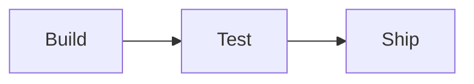

# Themes

A theme is data: every colour, material, label and line style the scene reads. Three ship with Bonkei, named by `THEME_NAMES`: `classic`, `bonkei` and `bonkei-landscape`. `classic` is the default.

<div class="grid4">




</div>

<p class="cap">classic · bonkei · bonkei-landscape</p>

## Choosing a theme

::: code-group
````md [Markdown]

````
```ts twoslash [React / JavaScript]
import { render, THEME_NAMES, BONKEI } from 'bonkei'

render(document.body, 'flowchart LR\n  A --> B', { theme: 'bonkei' }) // by name
render(document.body, 'flowchart LR\n  A --> B', { theme: { ...BONKEI, name: 'mine' } }) // or a whole Theme
console.log(THEME_NAMES)
```
```html [Script tag]
<bonkei-diagram theme="bonkei">
  flowchart LR
    Build --> Test --> Ship
</bonkei-diagram>
```
:::

In frontmatter it is Mermaid's own key: `config.theme: bonkei`.

## The trench rim on this site

Every diagram in these docs has a light rim round the lip of a tunnel's trench (`edge.rim`, with `edge.rimWidth`), set once for the site, so the trench shows against the dark floor. The Classic look's own rim is a dark shade of the floor. A diagram's own `themeVariables` win over it.

## Changing one thing

`config.themeVariables` lays single tokens over the theme, by dotted path. `node.form: landscape` stands a landscape form on each node.


A name that does not exist falls back to `classic` and reports a warning through [`onWarning`](./errors); so does a variable that does not exist.

## The theme objects

`CLASSIC`, `BONKEI` and `BONKEI_LANDSCAPE` are frozen `Theme` objects, for passing as `theme` or as a base to copy and edit. Their fields are in the [Theme](/api/interfaces/Theme) reference.
