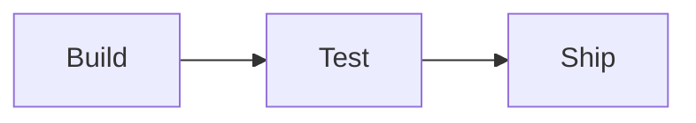
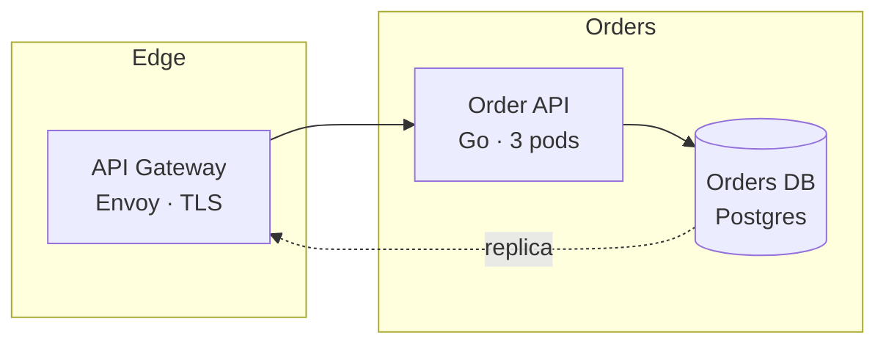
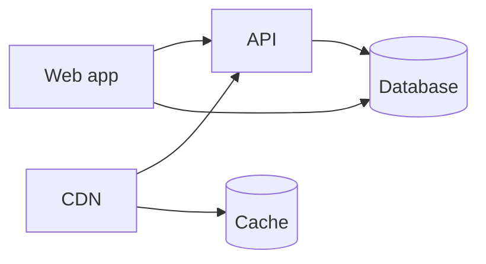

# Themes

A theme is data: every colour, material, label and line style the scene reads. Four ship with Bonkei, named by `THEME_NAMES`: `classic`, `bonkei`, `bonkei-landscape` and `cloud-cartography`. `classic` is the default.

<div class="grid4">




</div>

<p class="cap">classic · bonkei · bonkei-landscape</p>

`cloud-cartography` draws a diagram like an illustrated map of a system: each top-level subgraph is a coloured floor named in big capitals, each node an inked icon by its shape (rect a server, round a service, cylinder storage, diamond a decision) under a callout card, links are navy lines on the floor with one arrow partway along, and a dotted link (`-.->`) arcs overhead. A label written over two lines (`A["Order API<br>Go · 3 pods"]`) shows its second line as a subtitle on the card; the other themes still read it on one line.



<p class="cap">cloud-cartography</p>

## Choosing a theme

::: code-group
````md [Markdown]

````
```ts twoslash [React / JavaScript]
import { render, THEME_NAMES, BONKEI } from 'bonkei'

render(document.body, 'flowchart LR\n  A --> B', { theme: 'bonkei' }) // by name
render(document.body, 'flowchart LR\n  A --> B', { theme: { ...BONKEI, name: 'mine' } }) // or a whole Theme
console.log(THEME_NAMES)
```
```html [Script tag]
<bonkei-diagram theme="bonkei">
  flowchart LR
    Build --> Test --> Ship
</bonkei-diagram>
```
:::

In frontmatter it is Mermaid's own key: `config.theme: bonkei`.

## Changing one thing

`config.themeVariables` lays single tokens over the theme, by dotted path. `node.form: landscape` stands a landscape form on each node.


A name that does not exist falls back to `classic` and reports a warning through [`onWarning`](./errors); so does a variable that does not exist.

### The trench light

A tunnel's trench can be lit by the theme: a light along the floor, a wash on the walls and a rim round the lip. What each theme does on its own:

| Theme | Floor light and wall wash | Rim |
| --- | --- | --- |
| `classic` | On: grey-white `#e0e0e0` at 30% strength (core 2.1 wide; halo 6.6 wide at 0.17 opacity; wash intensity 0.18) | None (`edge.rim: none`) |
| `bonkei`, `bonkei-landscape` | Off (the colours are `null`) | Dark `#2A2622`, 2 wide, as it always was |

A diagram can change any part, so a Bonkei diagram can switch its light on, or a Classic one put a rim back:

| Token | What it is |
| --- | --- |
| `edge.rim`, `edge.rimWidth` | The rim round the lip: its colour and width. `none` draws no rim; `null` is a dark shade of the surface. Any other word that is not a colour is reported and the theme's rim kept. |
| `edge.glow` | `off` (or `false`) turns the floor light and the wall wash off. |
| `edge.glow.core`, `edge.glow.coreWidth` | The bright line along the floor. `null` leaves it out. |
| `edge.glow.halo`, `edge.glow.haloWidth`, `edge.glow.haloOpacity` | The soft, wider glow round that line; it also lights the walls from the floor up, fading to nothing at the lip, so the floor light shows where the floor itself is hidden (as in iso). `null` leaves it out. |
| `edge.glow.wash`, `edge.glow.washIntensity` | The faint light on the trench walls. `null` leaves it out. |



[Edge styles](./edge-styles#the-trench-light) has controls to try each part, and a diagram with its own rim.

## The theme objects

`CLASSIC`, `BONKEI` and `BONKEI_LANDSCAPE` are frozen `Theme` objects, for passing as `theme` or as a base to copy and edit. Their fields are in the [Theme](/api/interfaces/Theme) reference.
