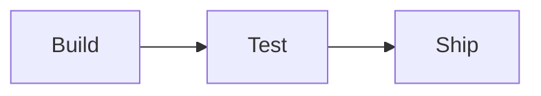
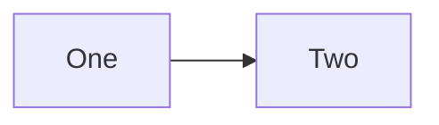

# VitePress

This site is built this way.

```sh
npm install vitepress
npm install @bonkei/vitepress
```

`@bonkei/vitepress` brings `bonkei`, `react`, `react-dom` and `three` with it.

## Two files

```ts [.vitepress/config.ts]
import { defineConfig } from 'vitepress'
import { bonkeiMarkdown } from '@bonkei/vitepress'

export default defineConfig({
  markdown: { config: md => bonkeiMarkdown(md, { height: 420 }) },
})
```

```ts [.vitepress/theme/index.ts]
import DefaultTheme from 'vitepress/theme'
import { enhanceAppWithBonkei } from '@bonkei/vitepress/client'

export default { extends: DefaultTheme, enhanceApp({ app }) { enhanceAppWithBonkei(app) } }
```

## Write a diagram

````md

````


That is the plugin drawing the fence above. The server renders a box of the right height, so the page does not jump when the diagram draws. Only pages with a diagram download Bonkei.

## Per-diagram settings

After `mermaid`, `{height=600}`, `{mode=flat}` and `{theme=bonkei}` set one diagram. The plugin's options set them site-wide; the fence wins.

````md

````


Any other fence is left to VitePress: see [Diagram types](./diagram-types). The plugin's full options are in [VitePress plugin](/reference/vitepress-plugin).
