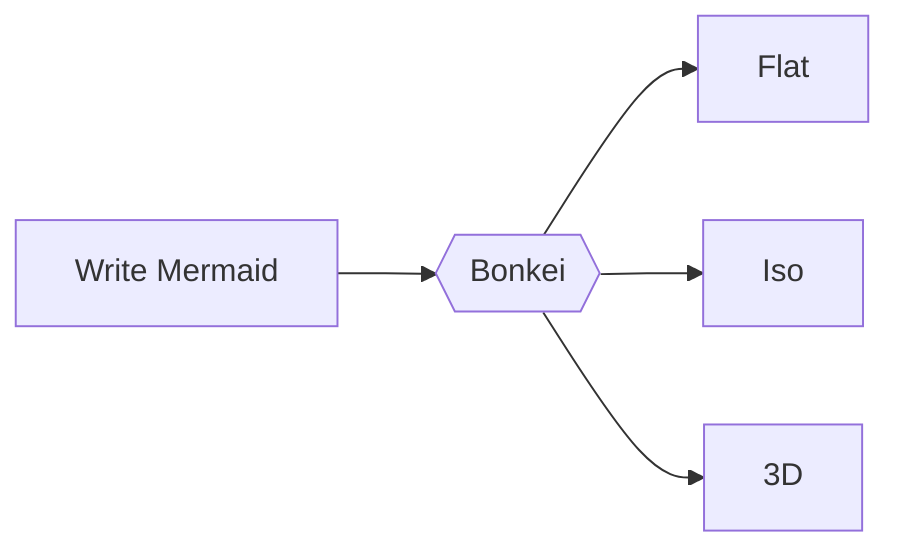
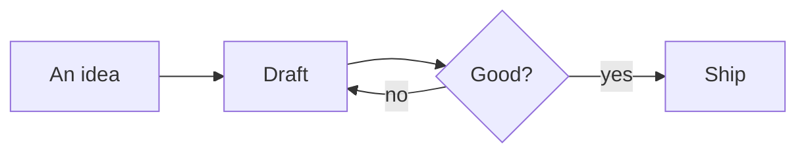

Live, drawn by the VitePress plugin from the fence in this page's Markdown. Drag it; the toolbar switches the view. Sample data, made up.

## Try it: edit the Mermaid

Change the text and the diagram follows. A line Bonkei cannot use is reported under the editor and the last good diagram stays.

<CopyOrDownloadAsMarkdownButtons />

This site is also an agent's way in: [`/docs/llms.txt`](/llms.txt) lists every page, [`/docs/llms-full.txt`](/llms-full.txt) holds them all, and every page has a Markdown copy beside it (add `.md` to its address).
