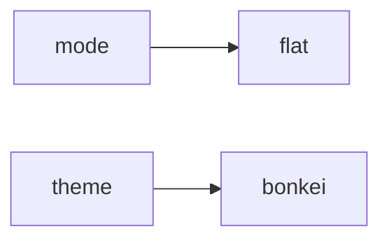

# Script tag element

`bonkei.global.js` defines the `<bonkei-diagram>` element and a global `Bonkei`. How to use it is on [Script tag](/guide/script-tag).

## The element

The element's text is the diagram (frontmatter allowed). It is a block element and keeps the `display` and height your stylesheet gives it.

| Attribute | Values | Default |
| --- | --- | --- |
| `mode` | `flat` · `iso` · `3d` | `iso` |
| `theme` | `classic` · `bonkei` · `bonkei-landscape` · `blueprint` · `lazers` | `classic` |
| `height` | a number of px, or a CSS length | `420` |

Changing `theme` on a drawn element redraws it in the new theme in the same view: the reader's zoom, pan and angle stay. Changing `mode` draws it afresh in that view.

Events, on the element: `bonkei-ready` when drawn, and `bonkei-error` with `detail.kind` and `detail.message`. Adding, moving and removing elements works as for any element.

## The global Bonkei

| Member | What it does |
| --- | --- |
| `Bonkei.render(el, source, options)` | The same as [`render`](/api/functions/render) |
| `Bonkei.run({ querySelector, nodes })` | Converts `<pre class="mermaid">` blocks that hold a flowchart or sequence diagram; returns how many |
| `Bonkei.isBonkeiError(x)` | The same as [`isBonkeiError`](/api/functions/isBonkeiError) |
| `Bonkei.isSupported(source)` | True for a flowchart or a sequence diagram |

