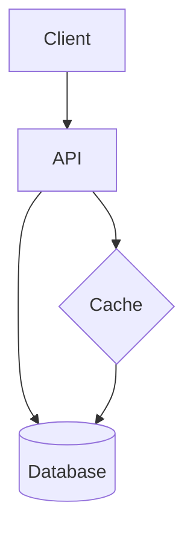
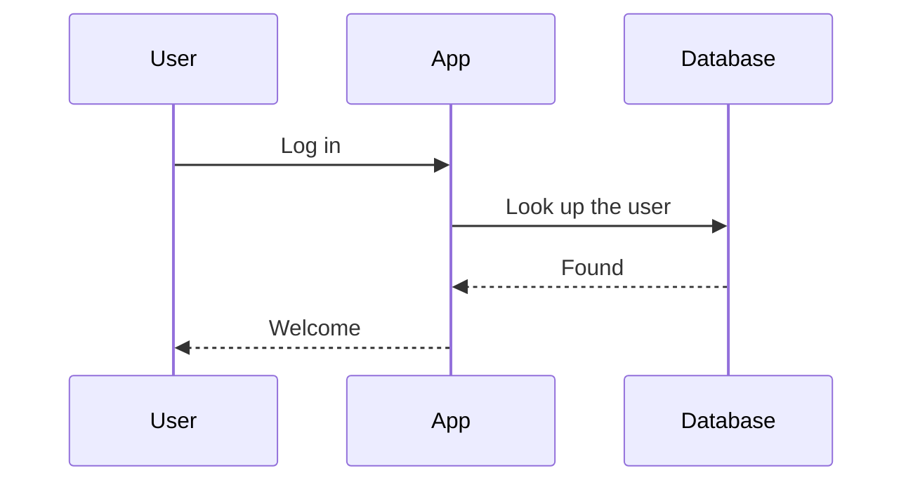
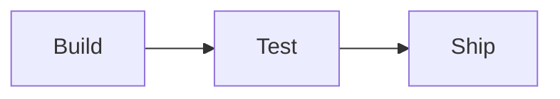
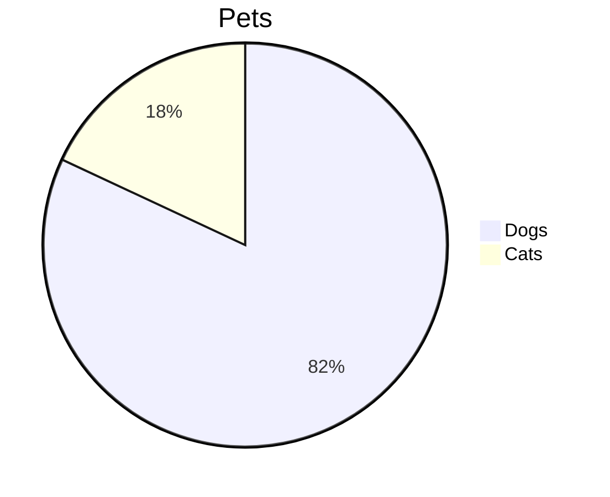

# Diagrams

A flowchart (the site-wide height, 420 px):

A sequence diagram:

A flowchart with its own height, 600 px:

A pie chart is not a type Bonkei draws, so the fence stays as the site would show it (here, a code block):

The paragraph below the diagrams.

