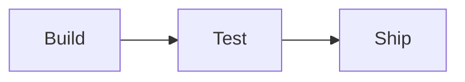

# @bonkei/vitepress (private, not yet published)

In a VitePress site, ` ```mermaid ` fences that hold a flowchart or a sequence diagram become Bonkei scenes. Any other fence
(a pie chart, a code block) goes to whatever rendered it before: VitePress's code block, or a Mermaid plugin installed earlier.

```sh
npm install @bonkei/vitepress     # brings bonkei, react, react-dom and three with it
```

```ts
// .vitepress/config.ts
import { defineConfig } from 'vitepress'
import { bonkeiMarkdown } from '@bonkei/vitepress'
export default defineConfig({ markdown: { config: md => bonkeiMarkdown(md, { height: 420 }) } })

// .vitepress/theme/index.ts
import DefaultTheme from 'vitepress/theme'
import { enhanceAppWithBonkei } from '@bonkei/vitepress/client'
export default { extends: DefaultTheme, enhanceApp({ app }) { enhanceAppWithBonkei(app) } }
```

````md

````

- **Height.** `height` in the plugin options sets every diagram (default 420 px); `{height=600}` after `mermaid` sets one. The
  server-rendered HTML already holds a box of that height, so the page does not jump when the diagram draws.
  `{mode=flat|iso|3d}` and `{theme=bonkei}` work the same way, and as site-wide options.
- **Only pages with a diagram pay.** Bonkei, React and three are loaded with a dynamic `import()` when a diagram mounts, so a
  page without one downloads none of them.
- **Dependencies, not peers.** `react`, `react-dom` and `three` are dependencies of this package: a Vue site has none of them,
  and `bonkei` needs them as peers, so the plugin brings them and the site installs one package. `vitepress` and `vue` are peers.
  VitePress's own `@docsearch/react` declares React < 19 as a peer, so the install prints a peer warning for it; it is harmless
  unless the site uses Algolia search.
- **Build-time report.** `onFence({ claimed, reason, file })` in the options is called for every fence: claimed, passed on and
  why, or claimed with a corrected value (a height that is not a number, an unknown mode).
- **Telemetry.** The component records a `bonkei.vitepress.load` span (the ms to load Bonkei; status ERROR, and a message in the
  box, if it could not); Bonkei's own spans follow. Both are no-ops unless the site registers an OpenTelemetry SDK.
- **Not yet:** following VitePress's dark/light switch; diagram types other than flowcharts and sequence diagrams.

`examples/vitepress` is a site using it; `pnpm smoke` (`scripts/smoke/embeds.mjs`) installs both packages from their tarballs
into a copy of it and checks it under `vitepress dev` and `vitepress build` + `preview`. What Mintlify allows, and the likely
route there, is in `examples/vitepress/mintlify.md`.
